# Loopreel Generation Pipeline: 9-Stage Flow & LLM Verification

This document specifies the execution topology of the Loopreel multi-stage carousel generation pipeline (`packages/generator/src/pipeline.ts`), detailing data contracts, LLM invocations, bounded healing loops, and Stage 9 browser assertions.

---

## 1. Pipeline Execution Flowchart

```mermaid
flowchart TD
    classDef llmNode fill:#1e1e24,stroke:#3b82f6,stroke-width:2px,color:#f8fafc;
    classDef codeNode fill:#1e1e24,stroke:#10b981,stroke-width:2px,color:#f8fafc;
    classDef auditNode fill:#1e1e24,stroke:#f59e0b,stroke-width:2px,color:#f8fafc;
    classDef gateNode fill:#1e1e24,stroke:#ef4444,stroke-width:2px,color:#f8fafc;

    INPUT["Raw Input: Prompt, Scraped URL, or Audio Transcript"] --> P1

    subgraph STAGE_1 ["Stage 1: Fact Extraction"]
        P1["Pass 1: Dossier Fact Extraction<br/>(LLM: gemini-2.5-pro / temp 0.2)"]:::llmNode
        P1 --> D1[("dossier.json")]
    end

    subgraph STAGE_2 ["Stage 2: Brand Styling"]
        D1 --> P2_CHECK{"Brand Preset<br/>Provided?"}
        P2_CHECK -- "Yes (e.g. the-fine-print)" --> P2_PRESET["Deterministic Preset Tokens"]:::codeNode
        P2_CHECK -- "No" --> P2_LLM["Pass 2: Bespoke Brand Kit Selection<br/>(LLM: palette, typography, motif)"]:::llmNode
        P2_PRESET --> D2[("brand.json")]
        P2_LLM --> D2
    end

    subgraph STAGE_3 ["Stage 3: Storyboard Deck"]
        D2 --> P3["Pass 3: Storyboard Deck Structuring<br/>(LLM: 7-slide narrative arc, word budgets)"]:::llmNode
        P3 --> D3[("deck.json")]
    end

    subgraph STAGE_4 ["Stage 4: Layout Blueprint"]
        D3 --> P4["Pass 4: Layout Blueprint & Token Binding<br/>(LLM: archetype mapping, density targets)"]:::llmNode
        P4 --> D4[("blueprints.json")]
    end

    subgraph STAGE_5 ["Stage 5: Spatial Architecture"]
        D4 --> P5["Pass 5: Spatial Layout Architecture<br/>(LLM: coordinates, flex orders, visual anchors)"]:::llmNode
        P5 --> D5[("layouts.json")]
    end

    subgraph STAGE_6 ["Stage 6: React TSX Generation"]
        D5 --> P6_QUEUE["FIFO Slide Task Queue<br/>(Slides 1 to 7)"]:::codeNode
        P6_QUEUE --> P6_POOL["Parallel LLM Pool (Concurrency = 3)<br/>Synthesizes React + Tailwind + Lucide TSX"]:::llmNode
        P6_POOL --> D6[("Slide01_*.tsx ... Slide07_*.tsx")]
    end

    subgraph STAGE_7 ["Stage 7: Deterministic Assembly & Bounded Healing"]
        D6 --> P7_ASM["Deterministic index.ts Assembly"]:::codeNode
        P7_ASM --> P7_AST{"Babel AST<br/>Syntax Check"}
        P7_AST -- "Parse Error" --> P7_AST_HEAL["AST Auto-Repair<br/>(Max 1 Attempt)"]:::codeNode
        P7_AST_HEAL --> P7_AST
        P7_AST -- "Valid" --> P7_TSC{"TypeScript Compiler<br/>(tsc --noEmit)"}
        P7_TSC -- "TS Errors" --> P7_TS_HEAL["LLM TypeScript Self-Healing<br/>(Bounded: attempt <= 3)"]:::llmNode
        P7_TS_HEAL --> P7_TSC
        P7_TSC -- "Pass" --> D7[("Verified Template Package")]
    end

    subgraph STAGE_8 ["Stage 8: Social Caption"]
        D7 --> P8["Pass 8: Journalistic Social Caption<br/>(LLM: hook, receipt summary, hashtags)"]:::llmNode
        P8 --> D8[("caption.json")]
    end

    subgraph STAGE_9 ["Stage 9: Playwright Visual Audit"]
        D8 --> P9_LOAD["Headless Chromium: Load Slide Preview Server<br/>(await document.fonts.ready + 300ms wait)"]:::codeNode
        P9_LOAD --> P9_AUDIT["Evaluate 8 DOM Assertions & AutoFit Scale"]:::auditNode
        P9_AUDIT --> P9_CHECK{"Audit Errors == 0<br/>& Scale >= 0.85?"}
        P9_CHECK -- "Fail" --> P9_FAILED["Mark Job Failed / Needs Review"]:::gateNode
        P9_CHECK -- "Pass" --> P9_COMPLETE["Job Status: Complete"]:::codeNode
    end

    subgraph NEWSROOM_GATE ["Newsroom Human Review Gate"]
        P9_COMPLETE --> NR_PENDING["Newsroom Story: pending_review"]:::gateNode
        NR_PENDING --> NR_HUMAN{"Human Editor<br/>Approval"}
        NR_HUMAN -- "pnpm newsroom --action=publish" --> NR_CLAIM["Atomic Claim: publishing"]:::codeNode
        NR_CLAIM --> NR_BUFFER["Buffer API Dispatch"]:::codeNode
        NR_BUFFER -- "Success" --> NR_SCHEDULED["Status: scheduled"]:::codeNode
        NR_BUFFER -- "Failure" --> NR_REVERT["Rollback to pending_review"]:::gateNode
    end
```

---

## 2. Stage Breakdown & LLM Call Count

When a deterministic brand kit preset (such as *The Fine Print*) is used, the pipeline executes **6 primary LLM calls**:

| Stage | Pass Name | Executing Agent / Tool | Primary LLM Call? | Primary Model | Temperature | Output Artifact |
| :---: | :--- | :--- | :---: | :--- | :---: | :--- |
| **1** | Dossier Fact Extraction | Fact Extraction Agent | **Yes** | `gemini-2.5-pro` | `0.2` | `dossier.json` |
| **2** | Brand Kit Selection | Deterministic Preset Loader | **No (Preset)** | — | — | `brand.json` |
| **3** | Storyboard Structuring | Editorial Deck Architect | **Yes** | `gemini-2.5-pro` | `0.4` | `deck.json` |
| **4** | Layout Blueprint | Token & Archetype Mapper | **Yes** | `gemini-2.5-pro` | `0.3` | `blueprints.json` |
| **5** | Spatial Architecture | Spatial Layout Architect | **Yes** | `gemini-2.5-pro` | `0.3` | `layouts.json` |
| **6** | React TSX Generation | Concurrency Pool (`p-limit: 3`) | **Yes** | `claude-3-5-sonnet` | `0.2` | `Slide01`..`Slide07.tsx` |
| **7** | Deterministic Assembly | AST & `tsc --noEmit` | **No** *(LLM on repair only)* | — | — | `index.ts` |
| **8** | Journalistic Caption | Social Caption Synthesizer | **Yes** | `gemini-2.5-pro` | `0.4` | `caption.json` |
| **9** | Playwright Visual Audit | Headless Browser Auditor | **No** | Chromium | — | `audit.json` / Screenshots |

> [!NOTE]
> If an un-preset brand is requested, Stage 2 executes an additional LLM call (total 7 primary LLM calls).
> Pass 8 (Social Caption) runs sequentially after Stage 7 in current code. Parallel execution alongside Stages 5–7 is scheduled for the pipeline concurrency optimization milestone.

---

## 3. Bounded Healing Loops & Failure Thresholds

Unbounded retry loops present severe cost, token, and latency risks. All healing loops in Loopreel are bounded:

### 1. Babel AST Syntax Auto-Repair (Stage 7)
- **Condition**: Generated component fails initial Babel AST parser pass.
- **Repair**: Deterministic code sanitizer applies regex fixes for common unescaped JSX quotes and trailing comma anomalies.
- **Limit**: Exactly **1 repair attempt**. If the AST remains unparseable, compilation immediately halts.

### 2. TypeScript Compiler Self-Healing (Stage 7)
- **Condition**: TypeScript compiler (`tsc --noEmit`) detects type mismatches or missing property signatures.
- **Healing**: Diagnostics and offending slide TSX are forwarded to the LLM healing prompt with compiler error lines.
- **Limit**: Bounded to **3 attempts** (`attempt <= 3` in `packages/generator/src/pipeline.ts`). If errors persist on attempt 4, the job throws a fatal error and terminates.

### 3. Visual Assertion Auditor (Stage 9)
- **Condition**: Headless Chromium renders slides at `http://localhost:5174` and verifies the 8 DOM assertions.
- **AutoFit Thresholds**:
  - `numericScale < 0.85`: Fatal layout error (slide content is excessively dense or tall).
  - `0.85 <= numericScale < 0.95`: Non-fatal warning logged for editorial inspection.
  - `numericScale >= 0.95`: Clean pass.
- **Space Utilization**: Emits a warning if content fill ratio `< 60%`.
- **Action**: Zero heuristic layout repair loops. The auditor functions as an unyielding quality barrier: any fatal assertion failure sets job status to `failed` or `needs_review`.

---

## 4. Newsroom Human Review Gate Flow

Once Stage 9 completes cleanly, the story enters the Newsroom Human Review Gate:

1. **State Reservation**: The story is persisted with status `pending_review`.
2. **Buffer Protection**: Even if the autonomous newsroom daemon is active, Buffer dispatch is bypassed by default.
3. **Editorial Review**: An operator reviews the generated slides in the Admin Console (`http://localhost:5175`).
4. **Atomic Claim & Publish**:
   - The operator executes `pnpm newsroom --action=publish --id=<storyId>`.
   - The system checks that the attached job is `complete` with 0 audit errors.
   - If the story originated from a prompt source (`source_type === 'prompt'`), the command requires `--confirm-unverified`.
   - An atomic SQL query claims the story into status `publishing`.
   - The story is scheduled via Buffer GraphQL API.
   - On success, the story moves to `scheduled` and records the Buffer post ID and approving editor.
   - On Buffer API error, the status reverts to `pending_review` with the error logged in metadata.
