# Loopreel Bespoke Codegen Pipeline: LLM Passes Architecture

This document specifies the exact stage-by-stage architecture, data contracts, and execution lifecycle of the **Bespoke Codegen Pipeline** inside `@loopreel/generator` and `@loopreel/worker-structure`.

---

## Detailed Pipeline Flowchart (Mermaid.js)

```mermaid
flowchart TD
    classDef inputClass fill:#1E222D,stroke:#4B5563,stroke-width:2px,color:#F3F4F6;
    classDef llmPass fill:#0F172A,stroke:#3B82F6,stroke-width:2px,color:#93C5FD;
    classDef codePass fill:#141E18,stroke:#10B981,stroke-width:2px,color:#A7F3D0;
    classDef auditPass fill:#261815,stroke:#EF4444,stroke-width:2px,color:#FECACA;
    classDef artifactClass fill:#1A1429,stroke:#8B5CF6,stroke-width:2px,color:#DDD6FE;
    classDef completeClass fill:#14231E,stroke:#059669,stroke-width:3px,color:#6EE7B7;

    subgraph INGESTION ["0. Ingestion & Job Normalization"]
        SRC_PROMPT["Editorial Prompt\n'prompt:Why Airlines Overbook...'"]:::inputClass
        SRC_URL["Web Article URL\n(Readability Extractor)"]:::inputClass
        SRC_YT["YouTube Video URL\n(Whisper / Deepgram)"]:::inputClass
        QUEUE_JOB["BullMQ Queue: structure\nPayload: options, brandKit, sourceUrl"]:::inputClass

        SRC_PROMPT --> QUEUE_JOB
        SRC_URL --> QUEUE_JOB
        SRC_YT --> QUEUE_JOB
    end

    subgraph PIPELINE_CORE ["Bespoke Generation Engine (8-Pass Architecture)"]
        
        %% Pass 1
        QUEUE_JOB --> P1["Pass 1: Forensic Fact & Research Bureau\n[LLM: Copilot / Claude 3.5 Sonnet]\nExtracts core conflict, numerical metrics,\nmechanisms, fine-print clauses, comparisons"]:::llmPass
        DOSSIER[("GroundTruthDossier\n(dossier.json)\n• metrics[]\n• mechanisms[]\n• finePrintClauses[]")]:::artifactClass
        P1 --> DOSSIER

        %% Pass 2
        DOSSIER --> P2_DECIDE{"Brand Kit Specified\nin Request?"}:::codePass
        P2_DECIDE -- "Yes / Slug Preset" --> P2_PRESET["Deterministic Preset Resolution\nCANONICAL_BRAND_PRESETS['the-fine-print']\nPaper: #0A0A0C | Ink: #F5F5F7 | Accent: #FF2A2A\nFonts: Playfair Display + Source Serif 4 + JetBrains Mono"]:::codePass
        P2_DECIDE -- "No (Generate Brand)" --> P2_LLM["Pass 2: Creative Director Art Direction\n[LLM: Copilot]\nSynthesizes brand tokens & vibe"]:::llmPass
        
        BRAND[("BrandTokens\n(brand.json)\n• palette (paper, ink, accent, surface)\n• typography (headline, body, mono)\n• wordmark & handle (@thefineprint.pub)")]:::artifactClass
        P2_PRESET --> BRAND
        P2_LLM --> BRAND

        %% Pass 3
        BRAND --> P3["Pass 3: Editorial Strategist\n[LLM: Copilot]\nFormulates scroll-stopping headline,\ncore conflict, and value proposition promise"]:::llmPass
        DOSSIER --> P3
        HOOK[("Hook & Conflict Promise\n'Your Confirmed Flight Can Leave Without You'")]:::artifactClass
        P3 --> HOOK

        %% Pass 4
        HOOK --> P4["Pass 4: Senior Copy Editor\n[LLM: Copilot]\nAuthors 7-Slide Storyboard with Strict Budgets\n• Slide 1: Cover (hook + kicker)\n• Slide 2: Context / The Bet\n• Slide 3: Comparison / The Choice\n• Slide 4: Mechanics / The Clock\n• Slide 5: Perimeter / The Trap\n• Slide 6: Evidence / The Receipts\n• Slide 7: Verdict / The Action Plan"]:::llmPass
        BRAND --> P4
        DOSSIER --> P4
        STORYBOARD[("Deck Storyboard\n(deck.json)\n7 Slides: kicker, headline, subheadline,\nitems[], visual topology")]:::artifactClass
        P4 --> STORYBOARD

        %% Pass 5
        STORYBOARD --> P5["Pass 5: Visual Art Director & Layout Architect\n[LLM: Copilot]\nPlans exact spatial blueprints for every slide:\n• allocatedHeightPx (e.g. 500-560px)\n• visualRegion bounding coordinates\n• semantic Lucide vector anchors\n• safeArea margins (1080x1350 Safe Zone)"]:::llmPass
        BRAND --> P5
        BLUEPRINTS[("SlideDesignBlueprint[]\nExact visual coordinates & SVG design brief")]:::artifactClass
        P5 --> BLUEPRINTS

        %% Pass 6 (Parallel Codegen)
        BLUEPRINTS --> P6_DISPATCH["Pass 6: Principal React Engineer Dispatcher\nParallel Codegen Workers (Concurrency: 3)"]:::codePass
        
        subgraph PARALLEL_SYNTHESIS ["Parallel Slide Codegen (Concurrency: 3)"]
            SLIDE_WORKER_1["Worker A\nSynthesizes Slide 01, 04, 07"]:::llmPass
            SLIDE_WORKER_2["Worker B\nSynthesizes Slide 02, 05"]:::llmPass
            SLIDE_WORKER_3["Worker C\nSynthesizes Slide 03, 06"]:::llmPass
        end

        P6_DISPATCH --> SLIDE_WORKER_1
        P6_DISPATCH --> SLIDE_WORKER_2
        P6_DISPATCH --> SLIDE_WORKER_3

        %% Self-Healing in Pass 6
        SLIDE_WORKER_1 & SLIDE_WORKER_2 & SLIDE_WORKER_3 --> AST_CHECK{"Syntax Valid?"}:::codePass
        AST_CHECK -- "Syntax Error / Unbalanced Tags" --> HEAL_AST["repairComponentSyntax\nAuto-repairs JSX closures & imports"]:::auditPass
        HEAL_AST --> AST_CHECK
        AST_CHECK -- "Clean JSX" --> SLIDE_FILES[("Slide Component Files (.tsx)\nSlide01_Cover.tsx ... Slide07_Verdict.tsx")]:::artifactClass

        %% Pass 7
        SLIDE_FILES --> P7["Pass 7: Assembly & TypeScript Verification\nGenerates index.ts entrypoint\nRuns tsc compiler audit across template"]:::codePass
        P7 --> TS_GATE{"TypeScript Errors?"}:::codePass
        TS_GATE -- "Errors Detected" --> HEAL_TS["healTemplateSourceFile\nSelf-healing LLM prompt with error diagnostics"]:::auditPass
        HEAL_TS --> P7
        TS_GATE -- "0 Errors" --> VERIFIED_TEMPLATE["Verified Template Package\npackages/generator/templates/<template-slug>/"]:::codePass

        %% Pass 8
        VERIFIED_TEMPLATE --> P8["Pass 8: Social Caption & Conversion Strategist\n[LLM: Copilot]\nSynthesizes Instagram caption with forensic receipts,\nchecklists, call-to-action, and 5 targeted hashtags"]:::llmPass
        CAPTION[("Social Caption\n(caption.json)\n• Full caption text\n• Hashtags\n• Receipts section\n• Guardrails")]:::artifactClass
        P8 --> CAPTION
    end

    subgraph AUDIT_AND_DELIVERY ["Playwright Visual Audit & Delivery"]
        CAPTION & VERIFIED_TEMPLATE --> PLAYWRIGHT["Automated Playwright Visual Audit\n(Headless Chromium @ 1080x1350)"]:::auditPass
        
        PLAYWRIGHT --> AUDIT_CHECKS{"Visual Audit Checks\n1. Element Collision Detection\n2. Safe-Area Text Overflow\n3. Font Loading Check\n4. SVG Canvas Bounding Box"}:::auditPass

        AUDIT_CHECKS -- "Collisions Detected" --> REPAIR_LAYOUT["Spatial Auto-Repair\n(Nudges overflowing elements / tightens scale)"]:::auditPass
        REPAIR_LAYOUT --> PLAYWRIGHT

        AUDIT_CHECKS -- "0 Collisions" --> SNAPSHOTS[("High-Resolution PNG Snapshots\nslide-01.png ... slide-07.png")]:::artifactClass

        SNAPSHOTS --> UPLOAD["Storage Asset Uploader\nUploads PNGs, SVGs, and metadata to storage/"]:::codePass
        UPLOAD --> DB_UPDATE["Database State Update\nstatus: 'complete'\nassetCount: 8, slideCount: 7"]:::completeClass
        DB_UPDATE --> ADMIN_UI["Admin Console Review URL\nhttp://localhost:5175/jobs/<JOB_ID>"]:::completeClass
    end
```

---

## Detailed Breakdown of Pipeline Passes

### Pass 1: Forensic Fact & Research Bureau
- **Role**: Journalistic research analyst.
- **Input**: Raw text (from web article scraper, YouTube transcription, or prompt topic).
- **Output**: `GroundTruthDossier` JSON.
- **Key Fields**:
  - `metrics`: Concrete numerical figures (`$1,075`, `200%`, `400%`, `15 minutes`).
  - `mechanisms`: Procedural corporate actions (overbooking, volunteer searches, involuntary bumping).
  - `finePrintClauses`: Conditions of carriage, legal codes (`14 CFR § 250.5`), liability waivers.
  - `comparisons`: Voluntary vs Involuntary, Domestic vs International delays.

### Pass 2: Creative Director Art Direction & Brand Presets
- **Role**: Master Art Director establishing brand aesthetics.
- **Deterministic Preset**: When `brandKit: "the-fine-print"` is requested, skips LLM guessing and pulls strictly from `CANONICAL_BRAND_PRESETS['the-fine-print']`:
  - `paper`: `#0A0A0C` (deep void black)
  - `ink`: `#F5F5F7` (crisp newsprint ivory)
  - `accent`: `#FF2A2A` (editorial redline accent)
  - `surface`: `#141418` (subtle dark card surface)
  - `typography`: `Playfair Display` (headline), `Source Serif 4` (body), `JetBrains Mono` (telemetry/kicker)
- **Dynamic Fallback**: If no preset is specified, LLM generates a custom brand token palette tailored to the subject.

### Pass 3: Editorial Strategist (Hook & Value Promise)
- **Role**: Senior Editor crafting the cover hook and reader contract.
- **Input**: `GroundTruthDossier` + `BrandTokens`.
- **Output**:
  - `hook`: A 5–7 word headline exposing the core tension (`"Your Confirmed Flight Can Leave Without You"`).
  - `valuePromise`: Explicit reader takeaway (`"Know when to negotiate—and when the airline owes you cash."`).

### Pass 4: Senior Copy Editor (7-Slide Storyboard)
- **Role**: Magazine copy editor writing slide text under strict editorial constraints.
- **Story Arc**:
  1. `cover`: The Hook & Core Conflict
  2. `context`: The Hidden Bet (How the airline operates)
  3. `comparison`: The Volunteer Switch (Voluntary vs Involuntary)
  4. `mechanics`: The Payment Clock (Delay calculation rules)
  5. `perimeter`: The Catch (Vouchers, blackout dates, waivers)
  6. `evidence`: The Receipts (200% vs 400% fare multipliers)
  7. `verdict`: The Action Plan (Actionable consumer defense checklist)
- **Editorial Constraints**:
  - Kicker: Max 2 words, uppercase mono badge.
  - Headline: Max 5–6 words (7 on cover), active, definitive phrasing.
  - Subheadline: Max 10–12 words contextualizing the mechanism.
  - Items: 2 items on slides 1–6 (or clean visuals); 3 actionable items on slide 7.

### Pass 5: Visual Art Director & Layout Architect
- **Role**: Spatial designer calculating exact coordinate budgets.
- **Output**: `SlideDesignBlueprint[]` for each slide.
- **Calculated Bounds**:
  - `allocatedHeightPx`: 500px–560px dedicated visual canvas height.
  - `safeArea`: Strict bounding box avoiding SlideFrame wordmark (top ~120px) and footer pagination (bottom ~80px).
  - `visualRegion`: Exact SVG canvas placement ensuring vertical centering (`Ratio ~ 1.0`).

### Pass 6: Principal React Engineer (Parallel Slide Synthesis)
- **Role**: Senior frontend engineer generating self-contained React TSX slides.
- **Concurrency**: 3 slides synthesized in parallel for speed (~30s per slide).
- **Visual Vocabulary**:
  - Semantic Lucide React icons used as structural anchor points.
  - Custom vector geometry: precise `<path>`, `<rect>`, `<g>` drawings.
  - Strict CSS variables: `var(--ink)`, `var(--paper)`, `var(--accent)`, `var(--surface)`.
- **Self-Healing Layer 1 (Syntax Repair)**:
  - If LLM generates unescaped characters or unclosed tags, `repairComponentSyntax` uses regex and AST analysis to auto-close JSX tags and format imports before disk write.

### Pass 7: Entry Point Assembly & TypeScript Verification
- **Role**: Build engineer assembling the template module.
- **Actions**:
  - Writes `index.ts` exporting the template configuration and slide array.
  - Persists `dossier.json`, `brand.json`, `deck.json`, and `caption.json`.
  - Runs `verifyTypeScriptIntegrity` using the TypeScript compiler API (`tsc --noEmit`).
- **Self-Healing Layer 2 (TypeScript Healing)**:
  - If `tsc` reports missing props or type mismatches, triggers `healTemplateSourceFile` with compiler error diagnostics to re-synthesize only the broken slide component.

### Pass 8: Social Caption & Conversion Copy
- **Role**: Social media strategist.
- **Output**:
  - Long-form investigative Instagram caption formatted with paragraph breaks.
  - "The Receipts" citation section (Conditions of Carriage, CFR statutes).
  - Actionable "Before You Sign / Volunteer" guardrail checklist.
  - 4–5 targeted hashtags (`#TheFinePrint`, `#PassengerRights`, etc.).

### Pass 9: Headless Playwright Visual Audit
- **Role**: Automated Quality Assurance inspector.
- **Harness**: Headless Chromium instance connected to the preview server (`http://localhost:5174`).
- **Audit Steps**:
  1. Emulates 1080x1350 viewport at DPR 1.0.
  2. Waits for web fonts (`Playfair Display`, `JetBrains Mono`) to reach `document.fonts.ready`.
  3. Evaluates DOM bounding boxes across all text and visual nodes.
  4. Runs AABB collision detection to ensure zero overlapping text elements.
  5. Verifies safe-area margins and vertical balance (`scale = 1.000` AutoFit pass-through).
  6. Captures pristine full-bleed PNG snapshots (`slide-01.png` ... `slide-07.png`).
- **Completion**:
  - Uploads snapshots to `storage/slides/<JOB_ID>/`.
  - Updates PostgreSQL job record to `complete`.
  - Displays interactive slide review in Admin Console (`http://localhost:5175/jobs/<JOB_ID>`).
