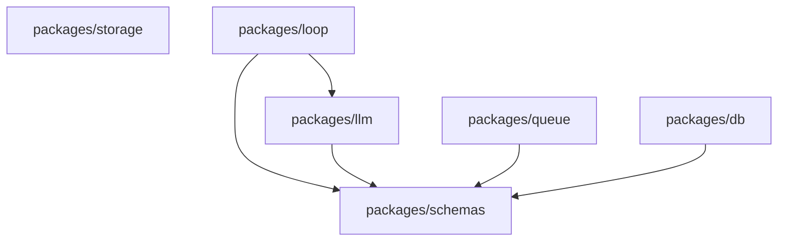

# Loopreel Monorepo: Apps & Packages Architecture Reference

This document serves as the comprehensive architectural reference for the Loopreel monorepo following the package consolidation and layout standardization.

---

## System Overview & Data Flow

```mermaid
flowchart LR
    User[User / Client] -->|POST /api/jobs| API[apps/api]
    API -->|Enqueue| Q1[(Queue: ingest)]
    
    Q1 --> WIngest[apps/worker-ingest]
    WIngest -->|Scraped text| Q2[(Queue: structure)]
    WIngest -.->|Audio stream| Q3[(Queue: transcribe)]
    
    Q3 --> WTranscribe[apps/worker-transcribe]
    WTranscribe -->|Transcribed text| Q2
    
    Q2 --> WStructure[apps/worker-structure]
    WStructure -->|Slide Payload JSON| Q4[(Queue: render)]
    
    Q4 --> WRender[apps/worker-render]
    WRender -->|Screenshots PNGs| Storage[(Storage: S3 / Local)]
    WRender -->|Complete status| DB[(PostgreSQL)]
    
    Admin[apps/admin] -.->|Monitor & inspect| DB
    Admin -.->|Monitor queues| Q1
```

---

## 1. Apps (`apps/`)

The `apps/` directory houses deployable microservices, background workers, and web applications.

### 1. `apps/api`
- **Role**: Public REST API Gateway.
- **Technology**: Fastify, Swagger/OpenAPI, Pino.
- **Port**: `3000`
- **Key Responsibilities**:
  - Exposes `POST /api/jobs` for submitting articles, blogs, or video URLs to generate carousel slides.
  - Exposes `GET /api/jobs/:id` for clients to poll job status and retrieve generated assets.
  - Validates all requests using `@loopreel/schemas`.
  - Persists initial job records in PostgreSQL via `@loopreel/db`.
  - Enqueues jobs into BullMQ via `@loopreel/queue`.

### 2. `apps/admin`
- **Role**: Internal Operations Dashboard.
- **Technology**: React 18, Vite, Tailwind CSS, TanStack Query, Lucide icons.
- **Port**: `5174`
- **Key Responsibilities**:
  - Provides administrative visibility into active, completed, and failed jobs.
  - Displays real-time worker logs, LLM token usages, and costs.
  - Allows previewing generated slide assets and re-triggering failed runs.

### 3. `apps/worker-ingest`
- **Role**: Source Ingestion & Content Scraper.
- **Technology**: Node.js worker, Puppeteer, Cheerio, yt-dlp, FFmpeg.
- **Queue**: `ingest`
- **Key Responsibilities**:
  - Fetches external content from URLs (Wikipedia, Substack, Medium, news articles, personal blogs).
  - Handles media sources (YouTube, MP3/video) by extracting clean audio tracks.
  - Cleans and strips HTML, tracking scripts, and advertisements to produce clean, high-density raw text.
  - Dispatches extracted text to `worker-structure` (or audio to `worker-transcribe`).

### 4. `apps/worker-transcribe`
- **Role**: Speech-to-Text Transcription Worker.
- **Technology**: Node.js worker, Whisper / Speech API.
- **Queue**: `transcribe`
- **Key Responsibilities**:
  - Processes audio streams uploaded from media URLs or video files.
  - Generates timestamped transcripts and structured dialogue logs.
  - Passes transcribed output forward to `worker-structure`.

### 5. `apps/worker-structure`
- **Role**: Multi-Phase AI Structuring & Editorial Engine.
- **Technology**: Node.js worker, `@loopreel/llm`, `@loopreel/loop/bridge`.
- **Queue**: `structure`
- **Key Responsibilities**:
  - **Phase 0 (Input Validation)**: Rejects error pages, paywalls, or content too brief to generate meaningful slides.
  - **Phase 1 (Brief Extraction)**: Extracts thesis statements, narrative hooks, and numerical metrics from raw text.
  - **Phase 1.5 & 2 (Classification & Selection)**: Categorizes domain (Science, Tech, Finance, Culture) and auto-selects the optimal editorial template.
  - **Phase 3 (Blueprint Planning)**: Maps out a 5–7 slide narrative arc (e.g. Cover → Sequence → Telemetry → Quote → CTA).
  - **Phase 4 (Copywriting)**: Generates high-impact, hook-driven copy constrained by strict template character boundaries.
  - **Phase 4.7 (Fidelity Audit)**: Performs anti-hallucination verification against the source text.
  - **Image Resolution**: Fetches contextual high-resolution photography via the built-in Unsplash service.
  - Dispatches validated slide payload JSON to `worker-render`.

### 6. `apps/worker-render`
- **Role**: High-Resolution Playwright Screenshot Pool.
- **Technology**: Node.js worker, Playwright / Chromium pool, local static server.
- **Queue**: `render`
- **Port**: `3001` (internal rendering static server)
- **Key Responsibilities**:
  - Maintains a pre-warmed pool of headless Chromium browser contexts.
  - Injects slide data, color schemes, brand kits, and CSS density variables into the Loop engine.
  - Captures pixel-perfect screenshots in 2x Retina resolution ($2160 \times 2700$).
  - Uploads PNG slide assets to storage (`@loopreel/storage`) and updates job records in `@loopreel/db`.

---

## 2. Core Packages (`packages/`)

The `packages/` directory contains 6 specialized, single-purpose shared libraries.

### 1. `packages/schemas`
- **Role**: The Single Source of Truth for Data Contracts.
- **Key Contents**:
  - **Data Models**: Zod schemas for jobs, payloads, brand kits, and slide items.
  - **Template Registry Keys**: Enums for the 4 production templates (`paper-of-record`, `the-globalist`, `the-curator`, `the-academic`).
  - **Platform Specifications** (`platforms.ts`): Dimensions, aspect ratios, typography scales, and safe zones for Instagram (Feed, Stories, Square), LinkedIn, X/Twitter, and Facebook.
  - **Error Classification** (`errors.ts`): `classifyError` utility that classifies errors into `transient` (retried by BullMQ with backoff) vs. `fatal` (immediately failed).

### 2. `packages/db`
- **Role**: Database ORM & Persistence.
- **Key Contents**:
  - Drizzle ORM schemas (`jobs`, `assets`, `users`, `events`).
  - PostgreSQL connection pool management.
  - Type-safe repositories (`JobRepository`, `AssetRepository`) for querying, updating checkpoints, and logging job progress.
  - SQL migration management.

### 3. `packages/queue`
- **Role**: Distributed Queue & Worker Infrastructure.
- **Key Contents**:
  - BullMQ queue and worker abstraction layer connected to Redis.
  - Queue factory functions (`createQueue`, `createWorker`).
  - Built-in retry and exponential backoff configuration (`QUEUE_RETRY_CONFIG`) applied automatically across all queues.

### 4. `packages/storage`
- **Role**: Storage & Asset Persistence.
- **Key Contents**:
  - Unified storage adapter interface.
  - Support for local filesystem storage (development) and Cloudflare R2 / AWS S3 (production).
  - Functions for uploading slides, downloading images, and generating presigned URLs.

### 5. `packages/loop`
- **Role**: React Presentation Canvas & Template Engine with Headless Node Bridge (`@loopreel/loop/bridge`).
- **Key Contents**:
  - **React Components**: Slide rendering engine for the 4 editorial design templates:
    - **The Paper of Record**: Authoritative broadsheet newspaper aesthetic.
    - **The Globalist**: Modern newsprint / geopolitical magazine aesthetic.
    - **The Curator**: Minimalist avant-garde gallery aesthetic.
    - **The Academic**: Structured research paper / working paper aesthetic.
  - **Standard Slide Layouts**: (`cover`, `sequence`, `telemetry`, `quote`, `cta`, `myth-fact`, `timeline`, `image-split`, `case-study`).
  - **Dynamic Density Engine** (`density-engine.ts`): Mathematical scaler that calculates CSS variables for typography, card heights, and margins based on text length.
  - **Headless Node Bridge** (`@loopreel/loop/bridge` subpath export):
    - Bridges template definitions into Node.js worker processes without requiring a DOM.
    - Template metadata registry (`TEMPLATES`).
    - Zod schema introspection (`introspectSchema`, `introspectSchemaConcise`) to supply LLMs with the exact required JSON structure.
    - Automated domain classifier and heuristic auto-selection (`autoSelectTemplate`).
    - Brand kit descriptions and prompt builders.

### 6. `packages/llm`
- **Role**: Multi-Phase Cognitive Brain & AI Providers.
- **Key Contents**:
  - Multi-provider LLM client supporting Google Gemini (2.5 Flash), OpenAI, Anthropic, and OpenRouter.
  - Multi-phase pipeline orchestrator (`orchestrator.ts`).
  - Prompt templates for domain classification, slide planning, copy generation, and headline validation.
  - Source fidelity auditor (anti-hallucination verification).
  - XML/JSON response sanitizers and token pricing calculators.
