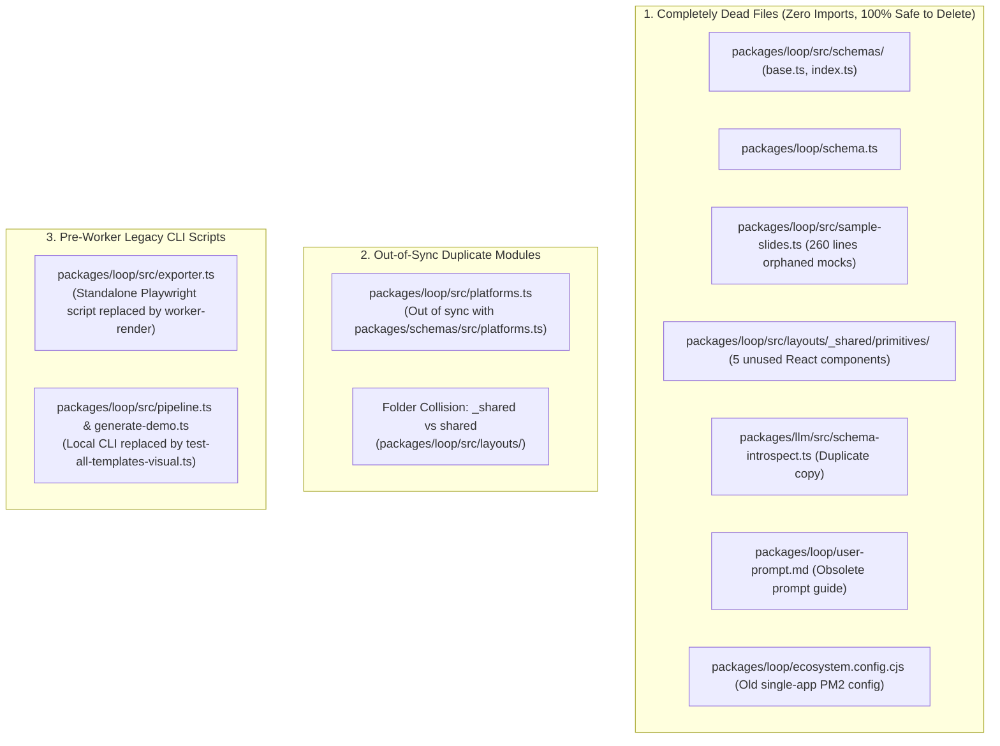

# Comprehensive Codebase Audit: Dead, Legacy & Duplicate Code

## Overview

We conducted an exhaustive codebase-wide scan across all 12 packages and apps in the monorepo to identify dead files, duplicate implementations, and architectural technical debt.

The audit revealed **11 completely dead files**, **2 out-of-sync duplicate modules**, and **an organizational folder collision** (`_shared` vs `shared`).

---

## Complete Dead & Legacy Code Inventory

---

## Detailed Findings

### 1. Completely Dead Files (Safe to Delete Immediately)
- **`packages/loop/src/schemas/` (`base.ts`, `index.ts`) & `packages/loop/schema.ts`**: Legacy global schema prototype; not exported or imported anywhere.
- **`packages/loop/src/sample-slides.ts`**: 260 lines of orphaned mock data with zero imports. Each layout has its own slides.
- **`packages/loop/src/layouts/_shared/primitives/` (6 files)**: `AdaptiveCover`, `AdaptiveCta`, `AdaptiveQuote`, `AdaptiveSequence`, `AdaptiveTelemetry`. Abandoned early experiment in shared components. Zero imports.
- **`packages/llm/src/schema-introspect.ts`**: Duplicate copy of schema introspection. Active production code uses `packages/loop/src/bridge/schema-introspect.ts`.
- **`packages/loop/user-prompt.md`**: Obsolete prompt instructions referencing non-existent files. Superseded by `docs/template-prompt-recipe.md` and the `template-converter` skill.
- **`packages/loop/ecosystem.config.cjs`**: Redundant single-app PM2 config. Root `ecosystem.config.cjs` manages all services.

### 2. Duplicate & Out-of-Sync Modules
- **`packages/loop/src/platforms.ts`**: Outdated platforms file (lacks Pinterest, wrong LinkedIn dimensions, `instagram-story` typo). Needs to be replaced with `@loopreel/schemas`.
- **Folder Collision**: `_shared/` vs `shared/` in `packages/loop/src/layouts/`. Having both causes confusion. They should be consolidated into `shared/`.

### 3. Layout Inconsistencies
- **Missing Schema**: `the-signal` is borrowing `PaperOfRecordContract` in `bridge/registry.ts`. Needs its own `TheSignalContract`.
- **Layout Granularity**: `paper-of-record`, `the-globalist`, `the-curator`, and `the-academic` have 12–19 subfolders each, whereas `the-signal` is cleanly consolidated into 5 files.

---

## Recommended Immediate Cleanup Action

1. Delete all 11 dead files in Category 1.
2. Replace `packages/loop/src/platforms.ts` with direct imports from `@loopreel/schemas`.
3. Add isolated `schema.ts` to `the-signal` and `_starter`.
4. Verify with `turbo run build typecheck` and `test-all-templates-visual.ts`.
