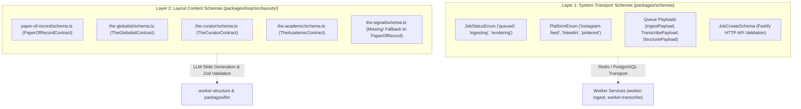

# Architectural Analysis: Layout-Owned Schemas vs. System Schemas

## Overview

You asked:
> *"I am wondering why doesn't each layout expose its schema from the layout folder? Why do we have a collective folder of schemas instead?"*

Your architectural intuition is spot-on. In a properly modular architecture, **each layout folder should be the 100% single source of truth for its own slide schemas, contract, brandkit, and styling.**

---

## The Two Distinct Layers of Schemas



---

### Layer 1: Why `packages/schemas` Exists (System Transport)
`packages/schemas` is **NOT** a collection of layout slide schemas. It is the **Monorepo System Transport Package**:
- **Microservice Decoupling**: We have 6 independent Docker microservices (`apps/api`, `apps/worker-ingest`, `apps/worker-transcribe`, `apps/worker-structure`, `apps/worker-render`, `apps/admin`).
- Services like `worker-transcribe` (which runs Whisper audio processing) or `worker-ingest` (which downloads YouTube streams via `yt-dlp`) only need to know:
  - Is `jobId` a valid UUID?
  - Is `sourceUrl` a valid URL?
  - What is the job's PostgreSQL status?
- If `packages/schemas` did not exist, `worker-transcribe` and `packages/db` would have to depend directly on `packages/loop`—pulling in React, Vite, PostCSS, CSS modules, and Chromium rendering code into lightweight Node backend containers!

---

### Layer 2: The Layout Content Schemas (Where We Need to Fix It)
The schemas that define **what slides a layout supports and what fields it requires** (`CoverSlideSchema`, `SequenceSlideSchema`, `TelemetrySlideSchema`, `QuoteSlideSchema`, `CtaSlideSchema`):

1. **The Good**: 4 of our layouts (`paper-of-record`, `the-globalist`, `the-curator`, `the-academic`) **already have their own `schema.ts`** inside their layout folders!
2. **The Flaw**: 
   - When we scaffolded `the-signal` and `_starter`, we omitted `schema.ts`.
   - In `packages/loop/src/bridge/registry.ts`, `the-signal` was forced to borrow `PaperOfRecordContract`:
     ```typescript
     'the-signal': {
       id: 'the-signal',
       schema: PaperOfRecordContract, // <--- Borrowing another layout's schema!
     }
     ```
   - Furthermore, `packages/schemas/src/index.ts` hardcoded the list of `TEMPLATE_KEYS`. This made developers feel that `packages/schemas` was dictating templates, when in reality templates should be self-contained in `packages/loop`.

---

## The Solution: 100% Layout-Owned Schemas

Each layout folder in `packages/loop/src/layouts/<template-id>/` will be 100% autonomous:

```text
packages/loop/src/layouts/<template-id>/
├── brandkit.ts           # Isolated palette, typography tokens, wordmark style
├── frame.tsx             # Isolated canvas frame & typographic masthead
├── frame.module.css      # Isolated CSS module styles
├── slides.tsx            # Isolated slide React components
├── schema.ts             # 👈 Isolated Zod schema & template contract
├── layout.tsx            # Isolated layout container
└── index.ts              # Public entry exporting layout, brandkit, & contract
```

### Key Changes:

1. **Add `schema.ts` to `packages/loop/src/layouts/_starter/schema.ts`**:
   - Every newly created or converted template automatically gets its own isolated Zod schema defining its slide models (`CoverSlideSchema`, `SequenceSlideSchema`, etc.) and contract.
2. **Add `schema.ts` to `packages/loop/src/layouts/the-signal/schema.ts`**:
   - Create `TheSignalContract` specifically tailored to `the-signal`.
   - Update `packages/loop/src/bridge/registry.ts` to use `TheSignalContract` instead of borrowing `PaperOfRecordContract`.
3. **Export Contract from Each Layout's `index.ts`**:
   - Each layout folder exports its own contract (`export { TheSignalContract } from './schema.js'`).
4. **Update `packages/loop/src/contracts.ts`**:
   - Re-export the contract directly from the layout directory.
5. **Update Antigravity `template-converter` Skill**:
   - Update the conversion checklist and scaffolding script (`scripts/create-template.ts`) to ensure `schema.ts` is always generated alongside `brandkit.ts`, `frame.tsx`, and `slides.tsx`.
