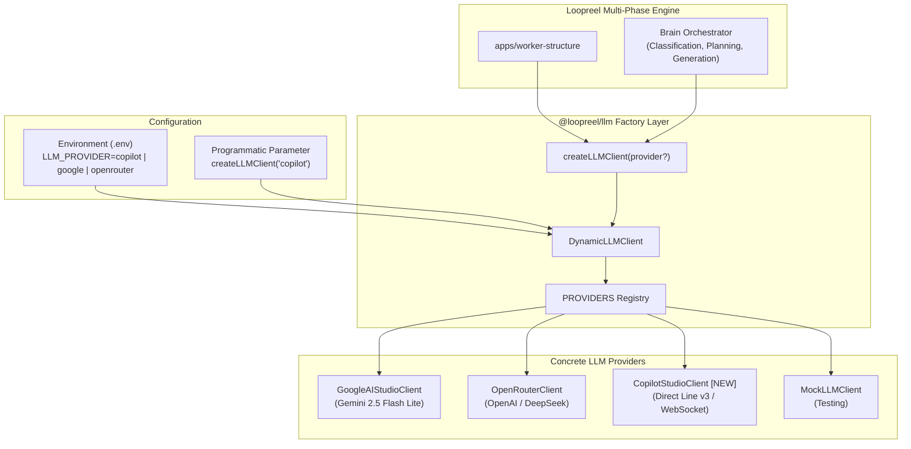

# Plan: Add Microsoft Copilot Studio LLM Provider to `@loopreel/llm`

## Goal Description
Integrate Microsoft Copilot Studio (Direct Line v3 API) from [`packages/llm-copilot-example`](file:///home/core/projects/loopreel/packages/llm-copilot-example) into [`packages/llm`](file:///home/core/projects/loopreel/packages/llm) as a production-grade, first-class LLM provider (`CopilotStudioClient`). Enable seamless switching between providers (`google`, `openrouter`, `copilot`, `mock`) via the `LLM_PROVIDER` environment variable and programmatically via `createLLMClient(provider?)`.

---

## User Review Required

> [!IMPORTANT]
> **Environment Variables for Copilot Studio**:
> The Copilot provider requires the following configuration in your `.env` file:
> ```env
> # Copilot Studio Direct Line Configuration
> DIRECT_LINE_SECRET="<YOUR_COPILOT_DIRECT_LINE_SECRET>"
> DIRECT_LINE_BASE_URL="https://europe.directline.botframework.com/v3/directline"
> ```
> To switch your active pipeline to Copilot Studio, simply set:
> ```env
> LLM_PROVIDER="copilot"
> ```
> When you wish to switch back to Google AI Studio:
> ```env
> LLM_PROVIDER="google"
> ```

> [!NOTE]
> **Zero External Dependencies**:
> Node.js 22+ (running Node v24.18.0) natively includes the standard WHATWG `WebSocket` API globally. `CopilotStudioClient` uses native `fetch` and global `WebSocket`, requiring zero extra npm packages in `packages/llm`.

---

## Architecture & Provider Switching



---

## Proposed Changes

### 1. `packages/llm` Core

#### [NEW] [`packages/llm/src/providers/copilot.ts`](file:///home/core/projects/loopreel/packages/llm/src/providers/copilot.ts)
Implement `CopilotStudioClient` following the `LLMClient` interface:
- **Token Management & Caching**: Exchange `DIRECT_LINE_SECRET` for a temporary conversation bearer token via `POST /tokens/generate`. Cache token with expiration (~25 min) to eliminate redundant token requests across multi-phase prompts.
- **Session Initialization**: Start conversation via `POST /conversations` to obtain session `conversationId` and real-time WebSocket `streamUrl`.
- **WebSocket Streaming & Activity Handling**:
  - Connect to `streamUrl` via native `WebSocket`.
  - Send message activity to `POST /conversations/{conversationId}/activities` with formatted `[SYSTEM INSTRUCTIONS]` and `[USER REQUEST]`.
  - Filter out client echoes (`activity.from.id === clientId`) and `typing` status activities.
  - Collect bot response from `activity.text` and card attachments.
  - Close socket cleanly and resolve with `{ text, usage: { promptTokens, completionTokens } }`.
- **Resilience**: Implement timeout handling and retry loop with exponential backoff for transient network errors.

#### [MODIFY] [`packages/llm/src/providers/index.ts`](file:///home/core/projects/loopreel/packages/llm/src/providers/index.ts)
- Register `copilot`, `copilot-studio`, and `directline` in `PROVIDERS` map.
- Update `DynamicLLMClient` to accept an optional `defaultProviderName?: string` in constructor, allowing programmatic override while defaulting to `process.env['LLM_PROVIDER'] ?? 'google'`.

#### [MODIFY] [`packages/llm/src/client.ts`](file:///home/core/projects/loopreel/packages/llm/src/client.ts)
- Update `createLLMClient(provider?: string): LLMClient` signature.

#### [MODIFY] [`packages/llm/src/pricing.ts`](file:///home/core/projects/loopreel/packages/llm/src/pricing.ts)
- Add zero-cost / passthrough entries for `copilot` and `copilot-studio` to `MODEL_PRICING` so usage metrics and cost calculation execute without errors.

#### [MODIFY] [`packages/llm/src/index.ts`](file:///home/core/projects/loopreel/packages/llm/src/index.ts)
- Export `CopilotStudioClient` alongside existing clients.

---

### 2. Applications & Environment Configuration

#### [MODIFY] [`.env`](file:///home/core/projects/loopreel/.env) & [`.env.example`](file:///home/core/projects/loopreel/.env.example)
- Add `DIRECT_LINE_SECRET` and `DIRECT_LINE_BASE_URL` from `packages/llm-copilot-example/.env`.
- Document `LLM_PROVIDER="copilot"` option.

#### [MODIFY] [`apps/worker-structure/src/index.ts`](file:///home/core/projects/loopreel/apps/worker-structure/src/index.ts)
- Update provider and model identification for metrics logging when `LLM_PROVIDER=copilot` (recording `provider: 'copilot'`, `model: 'copilot-studio'`).

---

## Verification Plan

### Automated & Standalone Verification
1. **TypeScript Build**:
   ```bash
   pnpm --filter @loopreel/llm run build
   pnpm turbo build
   ```
2. **Provider Switching Test**:
   Execute scratch test verifying both providers work and return valid responses:
   ```bash
   # Test Copilot Studio directly
   pnpm tsx scratch/test-copilot-provider.ts
   
   # Test DynamicLLMClient switching via LLM_PROVIDER
   LLM_PROVIDER=copilot pnpm tsx scratch/test-dynamic-switching.ts
   LLM_PROVIDER=google pnpm tsx scratch/test-dynamic-switching.ts
   ```

### Live Pipeline Manual Verification
1. **Restart Microservices**:
   ```bash
   pm2 restart all
   ```
2. **Execute Full Pipeline with Copilot Studio**:
   Submit live job via `submit-api-job.ts` with `LLM_PROVIDER=copilot`:
   ```bash
   LLM_PROVIDER=copilot pnpm tsx scripts/submit-api-job.ts \
     --url "https://en.wikipedia.org/wiki/Antikythera_mechanism" \
     --template the-field-notes \
     --platform instagram-feed \
     --wordmark "COPILOT FIELD NOTES" \
     --handle "@CopilotNotes" \
     --outDir output/the-field-notes-copilot
   ```
3. **Verify Generated Carousel Output**:
   - Inspect slides downloaded in `output/the-field-notes-copilot/`.
   - Confirm slide planning, content generation, and slide rendering completed successfully using Copilot Studio.
