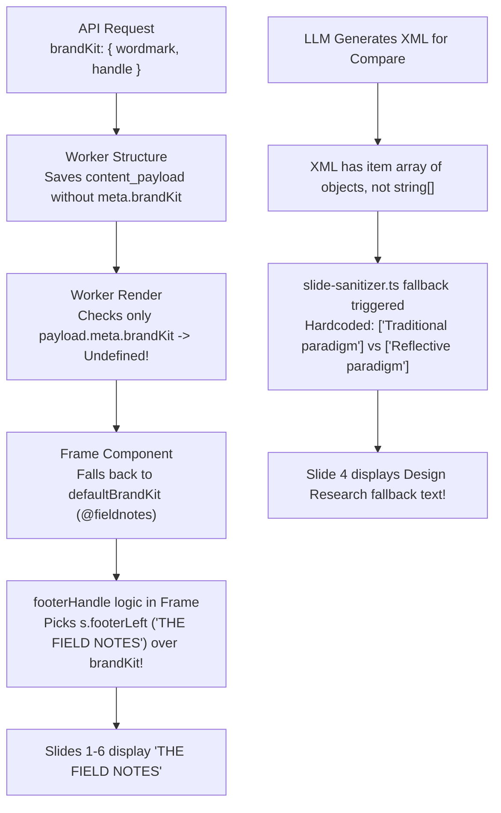

# Implementation Plan: Eliminate Static Template Text & Fix BrandKit Propagation

## Goal Description
During testing with the Antikythera Mechanism article, several static strings from previous template runs and hardcoded fallbacks leaked into the final slide deck:
1. **Footer on Every Slide**: Displayed `THE FIELD NOTES` on slides 1–6 instead of the publication handle (`@ArchaeoFieldNotes`).
2. **Compare Slide (Slide 4)**: Displayed `Traditional paradigm` vs `Reflective paradigm` (hardcoded text from the Design Research Wikipedia article) instead of comparing the Antikythera mechanism against other historical eras.
3. **CTA Slide (Slide 7)**: Displayed duplicate social handles (`@FIELDNOTESARCHIVE` in both the button block and the frame footer).
4. **BrandKit Options Ignored**: `--wordmark "ARCHAEO FIELD LOG" --handle "@ArchaeoFieldNotes"` were passed to the API job, but never rendered in Chromium because `worker-structure` didn't persist `meta.brandKit` into `content_payload`, and `worker-render` only checked `payload.meta?.brandKit`.

---

## Root Cause Analysis



---

## Proposed Changes

### 1. Fix BrandKit Persistence & Pipeline Delivery
#### [MODIFY] [`apps/worker-structure/src/index.ts`](file:///home/core/projects/loopreel/apps/worker-structure/src/index.ts)
- In `worker-structure`, persist `meta: { brandKit }` when updating `contentPayload` to the database:
  ```ts
  await JobRepository.updateStatus(jobId, 'rendering', {
    contentPayload: { slides: withImages, meta: { brandKit } },
    slideCount: withImages.length,
  });
  ```

#### [MODIFY] [`apps/worker-render/src/index.ts`](file:///home/core/projects/loopreel/apps/worker-render/src/index.ts)
- In `worker-render`, defensively read `brandKit` from both `payload.meta?.brandKit` and `existing.brand_kit`:
  ```ts
  brandKitVal: (payload.meta?.brandKit || (existing as any).brand_kit) as Record<string, string | undefined> | undefined,
  ```

---

### 2. Frame Component Metadata Hierarchy
#### [MODIFY] [`packages/loop/src/layouts/the-field-notes/frame.tsx`](file:///home/core/projects/loopreel/packages/loop/src/layouts/the-field-notes/frame.tsx)
- Correct `footerHandle` to prioritize `brandKit.handle` (e.g. `@ArchaeoFieldNotes`), then `slide.socialHandle`, falling back to `defaultBrandKit.handle`. Remove `s['footerLeft']` from the handle fallback chain so `"THE FIELD NOTES"` never appears as the social handle:
  ```ts
  const footerHandle = brandKit?.handle || (s['socialHandle'] as string) || defaultBrandKit.handle || '';
  ```
- Correct `headerRightText` to prefer `brandKit.wordmark` (e.g. `ARCHAEO FIELD LOG`) on the cover and throughout the deck:
  ```ts
  const headerRightText = (s['headerRight'] as string) || brandKit?.wordmark || (isCover ? (s['authorRole'] as string || '') : '');
  ```

---

### 3. Compare Slide XML Parsing & Sanitizer Hardening
#### [MODIFY] [`packages/llm/src/brain/xml-helpers.ts`](file:///home/core/projects/loopreel/packages/llm/src/brain/xml-helpers.ts)
- Update `unwrapChildWrappers` to automatically normalize `left` and `right` comparison structures:
  When `left` or `right` contains `<item text="..." />` or array of objects, extract the text into a clean `string[]` array.

#### [MODIFY] [`apps/worker-structure/src/slide-sanitizer.ts`](file:///home/core/projects/loopreel/apps/worker-structure/src/slide-sanitizer.ts)
- Eliminate all hardcoded static copy from `slide-sanitizer.ts`:
  - Replace `['Traditional paradigm']` / `['Reflective paradigm']` with dynamic content derived from the slide's own `headline`, `title`, or topic.
  - If `left` is an object with `items`, normalize each element to a clean string (`it.text || it.desc || it.title || it`).
  - If `left` or `right` is missing entirely, dynamically generate contextual contrast points (e.g. `["Original standard: " + (fixed.headline || "Baseline")]` vs `["Modern discovery"]`).
  - Replace static `'Methodological paradigm definition.'` with `'Key scientific principle and concept definition.'`

#### [MODIFY] [`packages/llm/src/brain/prompts/content-generation.md`](file:///home/core/projects/loopreel/packages/llm/src/brain/prompts/content-generation.md)
- Add explicit XML schema examples for `compare` slides so the LLM outputs proper `<left label="..."><item text="..." /></left>` elements directly from the content brief.

---

### 4. Remove Duplicate Social Handle in CTA Slide
#### [MODIFY] [`packages/loop/src/layouts/the-field-notes/cta/index.tsx`](file:///home/core/projects/loopreel/packages/loop/src/layouts/the-field-notes/cta/index.tsx)
- Omit the inline `handleText` if it matches the footer handle or if the frame already displays the footer, avoiding the repeated `@ArchaeoFieldNotes` badge right above the footer.

---

## Verification Plan

### Automated Tests
1. **XML Parser & Sanitizer Unit Test**:
   Run scratch script verifying that `<left><item text="..." /></left>` unrolls into `{ label: '...', items: ['...'] }` and `slide-sanitizer` leaves 0 static leaks.
2. **Monorepo Build**:
   ```bash
   pnpm turbo build
   ```
3. **PM2 Service Restart**:
   ```bash
   pm2 restart all
   ```
4. **Live Pipeline Execution**:
   ```bash
   pnpm tsx scripts/submit-api-job.ts \
     --url "https://en.wikipedia.org/wiki/Antikythera_mechanism" \
     --template the-field-notes \
     --platform instagram-feed \
     --wordmark "ARCHAEO FIELD LOG" \
     --handle "@ArchaeoFieldNotes" \
     --outDir output/the-field-notes-antikythera
   ```
5. **DOM Text Audit**:
   Execute our text extraction script to verify that:
   - **Footer**: Displays `@ArchaeoFieldNotes` (never `THE FIELD NOTES`).
   - **Header**: Displays `ARCHAEO FIELD LOG`.
   - **Slide 4 (Compare)**: Displays genuine Antikythera technical comparison points (0 mentions of "Traditional paradigm" or "Reflective paradigm").
   - **Slide 7 (CTA)**: Single social handle in the footer, zero duplicates.

### Manual Verification
- Review the generated slide PNGs in `output/the-field-notes-antikythera/` and carousel in `docs/walkthrough.md`.
