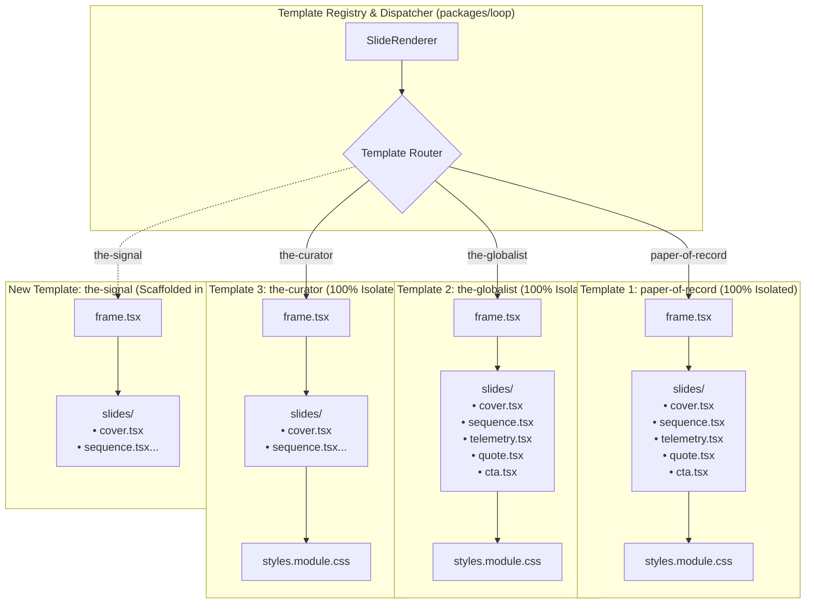

# Implementation Plan: 100% Isolated Template Architecture & Multi-Platform Engine

## Goal Description

You have raised a crucial design insight: **Templates must be 100% isolated, not forced into shared global components.**

Each editorial aesthetic has its own unique visual soul:
- **The Paper of Record**: Broadsheet journalism, multi-column drops, heavy black dividing rules, newspaper masthead.
- **The Globalist**: Geopolitical digest, red kicker rules, newsprint framed borders, subtle stat cards.
- **The Curator**: Avant-garde gallery, generous whitespace, asymmetric typography, italic serif accents.
- **The Academic**: Working paper, section symbols (`§`), bracketed citations, equation-style telemetry.

Forcing them into shared components would dilute their bespoke quality and create brittle coupling where tweaking one template risks breaking another.

This plan delivers:
1. **100% Isolated Template Plugin Architecture**: Each template is completely autonomous in its own folder with its own `frame.tsx`, slide components, CSS modules, and brandkit.
2. **Effortless Template Creation**:
   - Provide a clean **Starter Template Blueprint** and an automated **Scaffolding CLI** (`pnpm run create-template <name>`) so creating a new, fully isolated template takes **under 60 seconds**.
   - Templates only need to define the slides they care about (e.g. `cover`, `sequence`, `telemetry`, `quote`, `cta`), with graceful fallback for unneeded niche slides.
3. **Preserved Auto-Select + Strict Fixed Template Override**:
   - Auto-select remains the smart default for automated ingestion.
   - When the user selects a fixed template in Admin or API, auto-selection is 100% bypassed.
4. **Typographic Wordmarks & Handles (No Clunky JPEG Logos)**:
   - Deprecate raw raster image uploads (`logoUrl`) that cause pixelated artifacts and clashing backgrounds.
   - Implement **Typographic Wordmarks & Handles** (publication name, handle, font style, letterspacing) rendering crisp SVG/HTML typography at any resolution.
5. **Multi-Platform & Multi-Format Canvas Support**:
   - Native dimension and aspect ratio engine supporting:
     - **Instagram Feed** (4:5 / $1080 \times 1350$)
     - **Instagram Stories / Reels** (9:16 / $1080 \times 1920$)
     - **Square** (1:1 / $1080 \times 1080$)
     - **LinkedIn Document Carousel** (4:5 PDF)
     - **Pinterest / Long Pins** (2:3 / $1000 \times 1500$)
     - **Facebook / X**
6. **Pure Admin Testing Workflow**:
   - Zero credit logic, zero auth barriers, direct unmetered testing with saved BrandKit presets in `localStorage`.

---

## User Review Required

> [!IMPORTANT]
> **Total Template Autonomy**: Every template retains complete independence. No template shares internal layout JSX or CSS with another. You can freely edit, rewrite, or add experimental components to any template without affecting others.
> 
> **Auto-Select Remains Active**: By default, `templateId: 'auto'` uses the multi-phase LLM classifier to pick the best template. If you explicitly pick a template in `apps/admin` (e.g. `the-globalist`), the engine locks to that template with zero AI override.

---

## Architecture: The Isolated Template Plugin Model



---

## Proposed Changes

### Component 1: `packages/loop` Template Scaffolding & Registry

#### [NEW] Template Starter Blueprint (`packages/loop/src/templates/_template-starter/`)
A clean, minimal, fully typed starter template containing:
- `frame.tsx`: Isolated masthead, frame container, and footer.
- `slides/`: Clean single-file implementations of core slides (`cover.tsx`, `sequence.tsx`, `telemetry.tsx`, `quote.tsx`, `cta.tsx`) with their own isolated CSS modules.
- `brandkit.ts`: Default color schemes and typography tokens.
- `index.ts`: Clean export conforming to `TemplateModule`.

#### [NEW] `scripts/create-template.ts` (CLI Scaffolder)
A CLI tool that allows you to run:
```bash
pnpm run create-template the-signal "The Signal"
```
This automatically:
1. Clones the isolated starter template to `packages/loop/src/templates/the-signal/`.
2. Registers it in `packages/loop/src/layouts/index.ts` and `packages/loop/src/bridge/registry.ts`.
3. Adds it to the schema `TEMPLATE_KEYS`.
Ready to style in 30 seconds with 100% isolated code!

---

### Component 2: Typographic Wordmark & Handle System

#### [MODIFY] `packages/loop/src/layouts/shared/types.ts` & Schemas
Update `BrandKit` to support typographic branding:
```typescript
export interface BrandKitConfig {
  bg?: string;
  text?: string;
  accent?: string;
  surface?: string;
  fontSerif?: string;
  fontSans?: string;
  fontMono?: string;
  // Typographic Wordmark (Replaces JPEG logo)
  wordmark?: string;         // e.g., "THE GLOBAL DISPATCH"
  handle?: string;           // e.g., "@globaldispatch"
  wordmarkStyle?: 'serif' | 'sans' | 'mono' | 'small-caps';
}
```

#### [MODIFY] Template Frames (`paper-of-record/frame.tsx`, `the-globalist/frame.tsx`, etc.)
- Replace image `` with crisp vector typographic rendering:
  - If `brandKit.wordmark` is provided, renders the wordmark with custom letterspacing.
  - If `brandKit.handle` is provided, renders the handle badge cleanly in the footer.
  - No external image requests, zero pixelation, zero awkward white square backgrounds.

---

### Component 3: Multi-Platform Aspect Ratio Engine

#### [MODIFY] `packages/schemas/src/platforms.ts` & `packages/loop/src/SlideRenderer.tsx`
Standardize the canvas sizing engine for multiple social platforms:

| Platform Key | Dimensions | Aspect Ratio | Primary Use Case |
|---|---|---|---|
| `instagram-feed` | $1080 \times 1350$ | 4:5 | Carousel posts (Standard) |
| `instagram-stories` | $1080 \times 1920$ | 9:16 | Stories, Reels cover |
| `square` | $1080 \times 1080$ | 1:1 | Instagram Square, Facebook |
| `linkedin` | $1080 \times 1350$ | 4:5 | Multi-page PDF document carousel |
| `pinterest` | $1000 \times 1500$ | 2:3 | Standard Pinterest vertical pin |

`SlideRenderer` applies the correct CSS viewport and density profile based on the target platform aspect ratio.

---

### Component 4: `apps/worker-structure` (Strict Fixed Template Guarantee)

#### [MODIFY] `apps/worker-structure/src/index.ts`
Guarantee that auto-select only runs when requested:
```typescript
let targetTemplateId = existing.template_id;

// Only auto-select if templateId was unset or explicitly set to 'auto'
if (!targetTemplateId || targetTemplateId === 'auto') {
  jobLogger.info('Auto-selecting optimal template via Dynamic LLM Classifier...');
  const classification = await autoSelectTemplate(rawText);
  targetTemplateId = classification.templateId;
  jobLogger.info({ autoSelected: targetTemplateId }, 'Template auto-selected');
  await JobRepository.updateTemplate(jobId, targetTemplateId);
} else {
  jobLogger.info({ fixedTemplate: targetTemplateId }, 'Using user-selected fixed template (classifier bypassed)');
}
```

---

### Component 5: `apps/admin` (Direct Testing & Saved Presets)

#### [MODIFY] `apps/admin/src/components/BrandKitForm.tsx`
- Replace `logoUrl` input with **Typographic Wordmark** (`Publication Name`) and **Creator Handle** (`@handle`).
- Add **Save as Preset** and **Load Preset** buttons (stored in `localStorage`) so you can load your Instagram page's signature brand in 1 click every day.

#### [MODIFY] `apps/admin/src/pages/CreateJobPage.tsx`
- Platform selector includes: Instagram Carousel (4:5), Stories (9:16), Square (1:1), LinkedIn (4:5 PDF), Pinterest (2:3).
- Template selector defaults to `Auto-Select`, but clearly shows when a **Fixed Template** is locked.

---

## Verification Plan

### Automated Tests
1. Monorepo typecheck & build:
   ```bash
   pnpm turbo run build typecheck lint
   ```
2. Automated visual audit verifying all isolated templates:
   ```bash
   pnpm tsx scripts/test-all-templates-visual.ts
   ```
3. Test template generator CLI:
   ```bash
   pnpm run create-template test-template "Test Template"
   ```
   Verify new template compiles cleanly and is recognized by the registry.

### Manual Verification in Admin UI
1. Open Admin at `http://localhost:5174/create`.
2. Select **Fixed Template: The Curator**.
3. Fill in **Typographic Wordmark**: `"THE AVANT REVIEW"` and **Handle**: `"@avantreview"`.
4. Click **Generate** and confirm in worker logs that `the-curator` was strictly used and rendered with the typographic wordmark.
