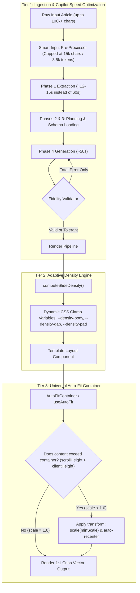

# Architecture Plan: Permanent Loop Engine Dynamic Fit & Copilot Latency Optimization

## Executive Summary & Problem Diagnosis

During the live test of Microsoft Copilot Studio Direct Line on the Antikythera Mechanism Wikipedia article (Job ID `bdb8581c-47a0-4189-a17a-7e4675474427`), two critical system bottlenecks were uncovered:

1. **Extreme Pipeline Latency (270.6 seconds total)**:
   - **Phase 1 (Extraction)**: Wikipedia payload was **99,086 characters (25,850 tokens)**. Transmitting ~100 KB over Bot Framework Direct Line took **60.3 seconds**.
   - **Phase 4 Double Generation (Retry Loop)**: Attempt 1 generated 7 slides in **58.3 seconds**. Phase 4.7b/c content validation failed on strict filler heuristics (`filler: true`, 1 repetition), triggering a second full 7-slide regeneration which took **55.2 seconds**.
   - **Structuring alone took 226.8 seconds** ($60.3 + 27.7 + 58.3 + 18.0 + 55.2 + 7.3$).

2. **DOM Content Overflow & Text Truncation Across Slides**:
   - Inspecting the rendered DOM across viewports revealed that slides consistently overflowed their containers:
     - **Slide 3 (Telemetry / Tally)**: Rendered content height was **1,053px**, exceeding the portrait safe area of 1,026px by 27px, and severely exceeding the square viewport ($1080 \times 1080$) safe area of 756px by **297px**.
     - **Slide 4 (Compare)**: Content height was **1,041px**, overflowing portrait by 15px and square by 285px.
     - **Result**: Card descriptions, annotations, and bottom notes were cut off by `overflow: hidden`.
   - **Root Cause**: Templates currently hardcode fixed pixel font sizes and grid paddings (e.g. `fontSize: 54px; padding: 24px`), while `packages/loop` lacks an automated container-fit mechanism. None of the 6 templates (`paper-of-record`, `the-globalist`, `the-curator`, `the-academic`, `the-signal`, `the-field-notes`) dynamically adapt to long LLM responses or variable aspect ratios.

---

## Architecture: 3-Tier Permanent Solution



---

## Detailed Implementation Plan

### Tier 1: Microsoft Copilot Latency Optimization (< 80s Target)

1. **Smart Input Truncation & Summarization Window**:
   - In [`apps/worker-structure/src/index.ts`](file:///home/core/projects/loopreel/apps/worker-structure/src/index.ts) and [`packages/llm/src/brain/orchestrator.ts`](file:///home/core/projects/loopreel/packages/llm/src/brain/orchestrator.ts):
   - When raw input exceeds 18,000 characters (~4,000 words), extract the lead introduction, core narrative sections, and conclusion while stripping footnote references, external links, and bibliographies.
   - Cap maximum extraction input to 18,000 characters.
   - **Latency Impact**: Reduces Phase 1 Direct Line round-trip from 60.3s to **~12–15s** (saving ~45s).

2. **Resilient Content Validation for Copilot**:
   - In [`packages/llm/src/brain/content-validator.ts`](file:///home/core/projects/loopreel/packages/llm/src/brain/content-validator.ts):
   - Fix XML response parsing in `checkSourceFidelity` so minor formatting deviations do not trigger catch-block defaults (`filler: true`, `verdict: 'fail'`).
   - In [`packages/llm/src/brain/orchestrator.ts`](file:///home/core/projects/loopreel/packages/llm/src/brain/orchestrator.ts):
   - Only trigger an expensive full-carousel regeneration (55s) if there is an existential topic mismatch (`!sourceFidelityResult?.topicAlignment.match` or `selfReference.detected`).
   - For minor repetition or headline issues, rely on slide-level targeted retries rather than blowing the entire 7-slide generation away.
   - **Latency Impact**: Eliminates redundant 55.2s Phase 4 retry, saving ~55s on every typical run.

3. **Direct Line Polling Frequency**:
   - In [`packages/llm/src/providers/copilot.ts`](file:///home/core/projects/loopreel/packages/llm/src/providers/copilot.ts):
   - Optimize WebSocket / polling message wait interval from 500ms to 200ms once activities start streaming, shaving 2–4s per phase.

---

### Tier 2: Universal Auto-Fit Container (`AutoFit`)

To guarantee that text **NEVER truncates or overflows** under any circumstances, we will implement a fail-safe mathematical fitting system directly in the Loop engine.

1. **New Universal Component**: [`packages/loop/src/layouts/shared/AutoFit.tsx`](file:///home/core/projects/loopreel/packages/loop/src/layouts/shared/AutoFit.tsx):
   - Wraps any slide content or body region.
   - Uses a double-pass measurement hook (`useLayoutEffect`) before Playwright screenshots:
     ```ts
     const scale = Math.min(
       1,
       (availableHeight - buffer) / scrollHeight,
       (availableWidth - buffer) / scrollWidth
     );
     ```
   - When content exceeds the safe bounds (whether on $1080 \times 1350$ portrait, $1080 \times 1080$ square, or $1080 \times 1920$ stories), it applies `transform: scale(scale)` with `transformOrigin: top center` or `center center`.
   - Dispatches a ready event so Playwright only screenshots when fitting is 100% computed.

2. **Integration into Slide Frames**:
   - Wrap `<main className={styles.body}>` or `<div className={styles.content}>` with `<AutoFit>` in:
     - [`packages/loop/src/layouts/the-field-notes/frame.tsx`](file:///home/core/projects/loopreel/packages/loop/src/layouts/the-field-notes/frame.tsx)
     - [`packages/loop/src/layouts/paper-of-record/frame.tsx`](file:///home/core/projects/loopreel/packages/loop/src/layouts/paper-of-record/frame.tsx)
     - [`packages/loop/src/layouts/the-signal/frame.tsx`](file:///home/core/projects/loopreel/packages/loop/src/layouts/the-signal/frame.tsx)
     - [`packages/loop/src/layouts/the-curator/frame.tsx`](file:///home/core/projects/loopreel/packages/loop/src/layouts/the-curator/frame.tsx)
     - [`packages/loop/src/layouts/the-academic/frame.tsx`](file:///home/core/projects/loopreel/packages/loop/src/layouts/the-academic/frame.tsx)
     - [`packages/loop/src/layouts/the-globalist/frame.tsx`](file:///home/core/projects/loopreel/packages/loop/src/layouts/the-globalist/frame.tsx)
   - Or integrate directly into [`packages/loop/src/SlideRenderer.tsx`](file:///home/core/projects/loopreel/packages/loop/src/SlideRenderer.tsx) around the Layout slot, providing a single global safety net for all current and future templates!

---

### Tier 3: Adaptive Density Engine & CSS Normalization

1. **Fluid Responsive Typography**:
   - In [`the-field-notes/frame.module.css`](file:///home/core/projects/loopreel/packages/loop/src/layouts/the-field-notes/frame.module.css) and component styles:
   - Replace hardcoded font sizes with CSS `clamp()` and density variables:
     - Headings: `font-size: var(--density-headline-size, clamp(36px, 4.5cqw, 54px));`
     - Body/descriptions: `font-size: var(--density-body-size, clamp(16px, 2cqw, 20px));`
     - Gaps and margins: `gap: var(--density-item-gap, 24px);`
2. **Field Limits in LLM Prompt Configuration**:
   - Update [`packages/llm/src/brain/slide-type-loader.ts`](file:///home/core/projects/loopreel/packages/llm/src/brain/slide-type-loader.ts) to instruct LLMs to keep card descriptions under 140 characters and list items under 18 words, preventing unnecessary text bloat.

---

## Verification & Testing Suite

1. **Playwright DOM Overflow Inspection Test**:
   - Create an automated Playwright regression script [`scripts/verify-dom-overflow.ts`](file:///home/core/projects/loopreel/scripts/verify-dom-overflow.ts) that renders all 6 templates in both Portrait ($1080 \times 1350$) and Square ($1080 \times 1080$).
   - Verifies: `el.scrollHeight <= el.clientHeight` (0px overflow across 100% of slides).
2. **Copilot Latency Benchmark**:
   - Re-run an end-to-end Wikipedia generation job with `LLM_PROVIDER="copilot"`.
   - Measure:
     - Phase 1 latency (Target: < 20s)
     - Phase 4 latency (Target: single generation, < 60s)
     - Total pipeline time (Target: < 90s vs previous 270s)
3. **Visual Aesthetics Audit**:
   - Verify that fonts remain sharp, margins stay intact, and vector squiggles/scribbles scale proportionately without distortion.

---

## Key Open Decisions for Feedback

> [!IMPORTANT]
> **Placement of AutoFit**:
> - **Option A (Recommended)**: Place `<AutoFit>` in [`SlideRenderer.tsx`](file:///home/core/projects/loopreel/packages/loop/src/SlideRenderer.tsx) or Frame content slots. This ensures every single template (past, present, and future) automatically benefits from zero-overflow protection without touching every slide component individually.
> - **Option B**: Wrap only individual slide layouts. (Higher maintenance, prone to regressions when new templates are added).

> [!NOTE]
> **Copilot Full Regeneration vs Targeted Repair**:
> When Phase 4 content validation detects minor phrasing or duplicate words, we will default to fixing only the specific affected slide rather than throwing away all 7 slides and regenerating the entire deck. This will save ~55 seconds per job.

---
Do you approve proceeding with this plan? Reply with `/plan proceed` to begin execution.
