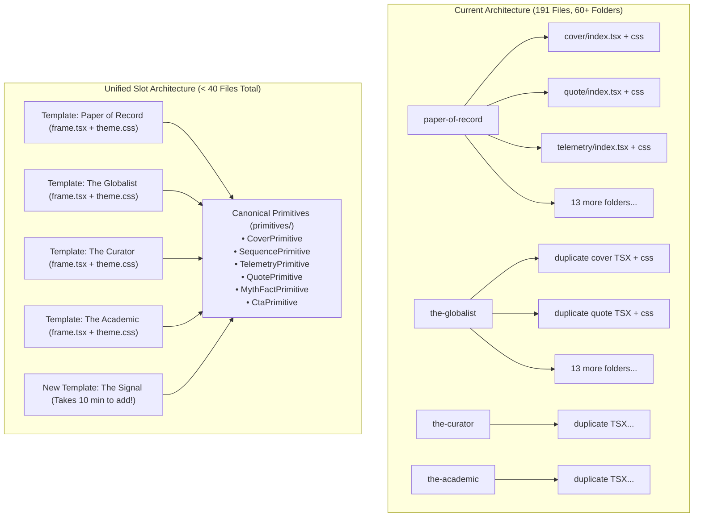

# Implementation Plan: `packages/loop` Simplification, Template Engine & Admin Workflow

## Goal Description

Currently, `packages/loop` contains **191 files** with heavy duplication: each of the 4 templates maintains 12–16 separate folders, each with duplicate React TSX boilerplate for `cover`, `sequence`, `quote`, `telemetry`, and `cta`. Adding a new template currently requires creating 30+ files across 15 folders. Furthermore, users cannot easily lock a fixed template or save their brand identity, and raw raster JPEG logos risk ruining slide aesthetics.

This plan outlines:
1. **Radical Simplification of `packages/loop`**: Refactoring from per-template duplicate React trees into **Canonical Slide Primitives** (`cover`, `sequence`, `telemetry`, `quote`, `myth-fact`, `timeline`, `image-split`, `cta`) paired with **Declarative Template Themes**. Adding a new template becomes a **10-minute, 2-file task** (`frame.tsx` + `theme.css`) with zero duplicate slide code.
2. **Fixed Template & BrandKit Enforcement**: Guaranteeing that when a user selects a template and brandkit in `apps/admin`, the pipeline strictly honors it without auto-classifier overrides.
3. **Typographic Wordmark & Handle System**: Replacing clunky raster JPEG uploads (`logoUrl`) with crisp, editorial **Typographic Wordmarks and Handles** (custom font, tracking, letterspacing, and badge style) that render flawlessly at any resolution.
4. **Multi-Platform Aspect Ratio Foundation**: Standardizing canvas containers to support Instagram Feed (4:5 / $1080 \times 1350$), Stories/Reels (9:16 / $1080 \times 1920$), Square (1:1 / $1080 \times 1080$), and LinkedIn Document PDF.
5. **Saved BrandKit Presets in `apps/admin`**: Saving your signature daily brand (colors, typography, wordmark, handle) in `localStorage` for 1-click loading during daily testing.

---

## User Review Required

> [!IMPORTANT]
> **No Breaking Changes to Generation API**: The public API contract (`/api/jobs`) and BullMQ job payload remain backwards-compatible. The simplification happens internally inside `packages/loop` and `apps/admin`.
> 
> **Replacing `logoUrl` with Typographic Wordmarks**: As requested, we deprecate raster image logos (which cause jagged artifacts and awkward white background boxes) in favor of high-typography wordmarks (e.g. `publicationName: "THE QUANTUM DISPATCH"`, `handle: "@quantum.dispatch"`, `font: "Serif" | "Sans" | "Mono"`).

---

## Architecture Comparison: Before vs. After



---

## Proposed Changes

### Component 1: `packages/loop` Simplification

#### [NEW] `packages/loop/src/primitives/`
Create canonical, highly polished, density-aware slide primitive components that receive slide data and render with CSS variables:
- `CoverPrimitive.tsx`: Kicker badge, headline, subheadline, byline author block.
- `SequencePrimitive.tsx`: Numbered step cards with dynamic step badge and body copy.
- `TelemetryPrimitive.tsx`: 2–3 metric cards with primary stat, delta indicator, and explanation label.
- `QuotePrimitive.tsx`: Large typographic quote mark, quote text, author attribution, and role.
- `MythFactPrimitive.tsx`: Side-by-side or stacked "Myth" vs "Fact" cards with indicator badges.
- `CtaPrimitive.tsx`: Textbook vertical centering, headline, subtext, action button, and typographic handle badge.
- `TimelinePrimitive.tsx`: Chronological milestone nodes.
- `ImageSplitPrimitive.tsx`: Half-canvas photograph paired with editorial text block.

#### [MODIFY] `packages/loop/src/templates/` (Replacing scattered layout folders)
Each template is reduced to a concise package:
```
templates/paper-of-record/
├── frame.tsx       (Masthead header, double-rule borders, typographic footer)
├── theme.css       (CSS variables: fonts, colors, border-radii, card surface styles)
└── index.ts        (Template metadata & optional custom slide overrides)
```
- If a template wants a standard `quote`, it simply renders `<QuotePrimitive />` which automatically inherits `theme.css`.
- If a template wants a unique custom `quote`, it can provide an override; otherwise it takes 0 code.

#### [NEW] `packages/loop/src/primitives/TypographicWordmark.tsx`
Renders a pristine vector-style text logo with letterspacing and styling:
- Handles uppercase editorial tracking, mono sub-badges, and author handles.
- Zero external image loading, zero CORS issues, zero pixelation.

---

### Component 2: `packages/schemas` (Wordmark & Platform Tokens)

#### [MODIFY] `packages/schemas/src/brandkits.ts` and `job.ts`
- Enhance `BrandKitSchema`:
  ```typescript
  export const BrandKitSchema = z.object({
    bg: z.string().optional(),
    text: z.string().optional(),
    accent: z.string().optional(),
    surface: z.string().optional(),
    fontSerif: z.string().optional(),
    fontSans: z.string().optional(),
    fontMono: z.string().optional(),
    // Typographic identity (replacing raw image logoUrl)
    wordmark: z.string().optional(),        // e.g. "THE GLOBAL DISPATCH"
    handle: z.string().optional(),          // e.g. "@globaldispatch"
    wordmarkStyle: z.enum(['serif', 'sans', 'mono', 'small-caps']).optional(),
  });
  ```
- Expand `PlatformSchema` supported aspect ratios:
  - `instagram-feed` ($1080 \times 1350$, 4:5)
  - `instagram-stories` ($1080 \times 1920$, 9:16)
  - `square` ($1080 \times 1080$, 1:1)
  - `linkedin` ($1080 \times 1350$, 4:5 PDF)
  - `pinterest` ($1000 \times 1500$, 2:3)

---

### Component 3: `apps/worker-structure` (Fixed Template Enforcement)

#### [MODIFY] `apps/worker-structure/src/index.ts`
- Ensure that if `job.template_id` is specified and not `'auto'`, the auto-classifier is completely bypassed:
  ```typescript
  if (!targetTemplateId || targetTemplateId === 'auto') {
    const classification = await autoSelectTemplate(rawText);
    targetTemplateId = classification.templateId;
  } else {
    jobLogger.info({ fixedTemplate: targetTemplateId }, 'Using user-selected fixed template');
  }
  ```

---

### Component 4: `apps/admin` (Direct Testing & Saved BrandKits)

#### [MODIFY] `apps/admin/src/components/BrandKitForm.tsx`
- Replace `logoUrl` input with **Typographic Wordmark & Handle** fields:
  - Publication Wordmark (e.g., `THE QUANTUM DISPATCH`)
  - Handle (e.g., `@quantum.dispatch`)
  - Wordmark Style selector (`Serif`, `Sans`, `Mono`, `Small-Caps`)
  - Preset BrandKit save/load buttons: "Save as Preset", "Load My Preset" (persisted to `localStorage`).

#### [MODIFY] `apps/admin/src/pages/CreateJobPage.tsx`
- Auto-load last used BrandKit and preferred template.
- Clear indicator showing whether the job will run in `Auto-Select` or `Fixed Template` mode.

---

## How Easy Will It Be to Add a New Template?

With this refactoring, adding a new template (e.g. `the-signal`) will require only **1 step**:
1. Create `packages/loop/src/templates/the-signal/index.ts`:
   ```typescript
   export const theSignalTemplate: TemplateDefinition = {
     id: 'the-signal',
     name: 'The Signal',
     theme: {
       fontDisplay: 'Geist',
       fontBody: 'Inter',
       fontMono: 'Geist Mono',
       bg: '#0F172A',
       text: '#F8FAFC',
       accent: '#38BDF8',
       surface: '#1E293B',
       border: '#334155',
       cardRadius: '12px',
     },
     frame: SignalFrame, // Custom masthead and footer
   };
   ```
No duplicate `quote/`, `cover/`, `sequence/`, `telemetry/`, or `cta/` files required!

---

## Verification Plan

### Automated Tests
1. Monorepo build, typecheck, and lint:
   ```bash
   pnpm turbo run build typecheck lint
   ```
2. Automated visual test suite:
   ```bash
   pnpm tsx scripts/test-all-templates-visual.ts
   ```
   Verify all slides render across all active templates with pixel-perfect fidelity.

### Manual Verification in Admin UI
1. Open Admin UI at `http://localhost:5174/create`.
2. Select a **Fixed Template** (e.g., `the-globalist`).
3. Set a **Typographic Wordmark** (e.g., `THE SILICON CHRONICLE`) and handle (`@siliconchronicle`).
4. Click **Generate** and verify in logs and output that `the-globalist` was strictly used and the typographic wordmark appears cleanly formatted on the slides.
