# Implementation Plan: Modularize The Field Notes into Folder-Based Component Architecture

## Goal Description
Refactor **The Field Notes** (`packages/loop/src/layouts/the-field-notes/`) from a single monolithic 1,650-line `slides.tsx` file into modular, isolated component folders matching the architectural standard of **The Paper of Record**, **The Academic**, **The Curator**, and **The Globalist**.

Each of the 17 slide components will reside in its own dedicated directory with an `index.tsx` (and component-specific styles or shared imports), while hand-drawn vector primitives (`Squiggle`, `CircNumber`, `Arrow`, `XMark`, `Box`, `Compass`), `renderMarkedText`, and `SlideWrapper` are cleanly extracted into a dedicated `primitives.tsx` module.

---

## User Review Required

> [!NOTE]
> **Zero Breaking Changes / Full Compatibility**:
> - [`layout.tsx`](file:///home/core/projects/loopreel/packages/loop/src/layouts/the-field-notes/layout.tsx) will import directly from each individual component folder (`./cover/index.js`, `./statement/index.js`, etc.).
> - [`slides.tsx`](file:///home/core/projects/loopreel/packages/loop/src/layouts/the-field-notes/slides.tsx) will be preserved as a clean barrel re-export module so any external tools or legacy references remain 100% operational.
> - The sample slides (`sample-slides.ts`), Zod contracts (`schema.ts`), and LLM prompt configs (`slide-types.yaml`) remain identical.

---

## Architectural Layout

```mermaid
graph TD
  Layout["layout.tsx (Registry Dictionary)"] --> Cover["cover/index.tsx"]
  Layout --> Statement["statement/index.tsx"]
  Layout --> List["list/index.tsx"]
  Layout --> Specimen["specimen/index.tsx"]
  Layout --> Measure["measure/index.tsx"]
  Layout --> Tally["tally/index.tsx"]
  Layout --> Route["route/index.tsx"]
  Layout --> Log["log/index.tsx"]
  Layout --> Compare["compare/index.tsx"]
  Layout --> Table["table/index.tsx"]
  Layout --> Chart["chart/index.tsx"]
  Layout --> Map["map/index.tsx"]
  Layout --> Quote["quote/index.tsx"]
  Layout --> Entry["entry/index.tsx"]
  Layout --> QA["qa/index.tsx"]
  Layout --> Kit["kit/index.tsx"]
  Layout --> CTA["cta/index.tsx"]

  Cover & Statement & List & Specimen & Measure & Tally & Route & Log & Compare & Table & Chart & Map & Quote & Entry & QA & Kit & CTA --> Primitives["primitives.tsx (SVGs, Highlighter, SlideWrapper)"]
  Cover & Statement & List & Specimen & Measure & Tally & Route & Log & Compare & Table & Chart & Map & Quote & Entry & QA & Kit & CTA --> FrameCSS["frame.module.css"]
```



---

## Proposed Changes

### 1. Shared Primitives Extraction
#### [NEW] `packages/loop/src/layouts/the-field-notes/primitives.tsx`
Extract reusable vector primitives and annotation engines:
- Vector SVGs: `Squiggle`, `CircNumber`, `Arrow`, `XMark`, `Box`, `Compass`
- Text highlighter engine: `renderMarkedText(text)`
- Annotation wrapper: `SlideWrapper({ slide, children })`

---

### 2. Component Folders (17 Isolated Components)
Create individual folders in `packages/loop/src/layouts/the-field-notes/`:

1. #### [NEW] `cover/index.tsx` — Cover Slide Component
   - Editorial headline, kicker, subheadline, author meta chips, washi tape accent.
2. #### [NEW] `statement/index.tsx` — Statement Slide Component
   - Oversized display statement, handwriting scribbles, footnote notes.
3. #### [NEW] `list/index.tsx` — List / Sequence Slide Component
   - Circled numbers 1-5, dashed border dividers, substantive fallback if empty.
4. #### [NEW] `specimen/index.tsx` — Specimen Slide Component
   - Washi-tape pinned card, phonetic pronunciation, part of speech, origin tag.
5. #### [NEW] `measure/index.tsx` — Measure Slide Component
   - Oversized statistic, rotated hand-drawn unit, tickmark ruler calibration.
6. #### [NEW] `tally/index.tsx` — Tally / Telemetry Slide Component
   - Multi-metric survey grid with quantitative readings and descriptions.
7. #### [NEW] `route/index.tsx` — Route Slide Component
   - Waypoints with dashed connectors, circled step numbers, and labels.
8. #### [NEW] `log/index.tsx` — Log Slide Component
   - Chronological field timeline entries with timestamps and "here" indicator.
9. #### [NEW] `compare/index.tsx` — Compare Slide Component
   - Two-column contrast card (Before vs. After / Paradigm A vs. Paradigm B).
10. #### [NEW] `table/index.tsx` — Table Slide Component
    - Field survey data table with column headers, dashed grid rows, and tag.
11. #### [NEW] `chart/index.tsx` — Chart Slide Component
    - Comparison bar chart with hand-drawn axes and percentage metrics.
12. #### [NEW] `map/index.tsx` — Map Slide Component
    - Coordinate map card with compass rose and waypoint annotations.
13. #### [NEW] `quote/index.tsx` — Quote Slide Component
    - Oversized quotation mark, italic quote text, author attribution, and role.
14. #### [NEW] `entry/index.tsx` — Entry Slide Component
    - Journal reflection with illuminated drop-cap serif typography and date stamp.
15. #### [NEW] `qa/index.tsx` — QA Slide Component
    - Interrogation card with circled Q & A badges, question text, and answer.
16. #### [NEW] `kit/index.tsx` — Kit Slide Component
    - Field diagnostic checklist with interactive state checkboxes (`done`, `open`, `flag`).
17. #### [NEW] `cta/index.tsx` — CTA Slide Component
    - Final action callout with bookmark button, author sign-off, and social handle.

---

### 3. Registry & Barrel Re-exports

#### [MODIFY] `packages/loop/src/layouts/the-field-notes/layout.tsx`
- Replace imports from `./slides.js` with individual folder imports:
  ```tsx
  import Cover from './cover/index.js';
  import Statement from './statement/index.js';
  import List from './list/index.js';
  import Specimen from './specimen/index.js';
  import Measure from './measure/index.js';
  import Tally from './tally/index.js';
  import Route from './route/index.js';
  import Log from './log/index.js';
  import Compare from './compare/index.js';
  import Table from './table/index.js';
  import Chart from './chart/index.js';
  import MapSlide from './map/index.js';
  import Quote from './quote/index.js';
  import Entry from './entry/index.js';
  import Qa from './qa/index.js';
  import Kit from './kit/index.js';
  import Cta from './cta/index.js';
  ```
- Map all 17 slide types and pipeline aliases (`sequence: List`, `telemetry: Tally`, `'myth-fact': Compare`, etc.).

#### [MODIFY] `packages/loop/src/layouts/the-field-notes/slides.tsx`
- Re-export all 17 components and primitives as a clean barrel module:
  ```tsx
  export { default as Cover } from './cover/index.js';
  export { default as Statement } from './statement/index.js';
  export { default as List, default as Sequence } from './list/index.js';
  export { default as Specimen } from './specimen/index.js';
  export { default as Measure } from './measure/index.js';
  export { default as Tally, default as Telemetry } from './tally/index.js';
  export { default as Route } from './route/index.js';
  export { default as Log } from './log/index.js';
  export { default as Compare } from './compare/index.js';
  export { default as Table } from './table/index.js';
  export { default as Chart } from './chart/index.js';
  export { default as MapSlide } from './map/index.js';
  export { default as Quote } from './quote/index.js';
  export { default as Entry } from './entry/index.js';
  export { default as Qa } from './qa/index.js';
  export { default as Kit } from './kit/index.js';
  export { default as Cta } from './cta/index.js';
  export * from './primitives.js';
  ```

---

## Verification Plan

### Automated Tests
1. **Monorepo Build**:
   ```bash
   pnpm --filter @loopreel/loop build
   pnpm turbo build
   ```
2. **Visual Static Audit (All 37 Slides across 6 templates)**:
   ```bash
   pnpm tsx scripts/test-all-templates-visual.ts
   ```
   Ensures `the-field-notes` renders all 17 slides identically to before.

### Manual Verification
- Verify that `packages/loop/src/layouts/the-field-notes/` has clean, consistent subdirectories matching `paper-of-record/` and `the-academic/`.
- Update `docs/walkthrough.md` documenting the modular folder structure.
