# Streamlined "HTML Design Reference → Production Template" Workflow

## Goal & Background

You asked:
> *"See the way I usually create templates is basically use online ChatGPT, Gemini, or Claude chat to create a template single HTML (the same in `packages/loop/design-references`), then put it there and ask you to convert it into a proper template following the same design style. Is this flow good? And if yes, how can we improve it or streamline it?"*

### Verdict: **This Flow is Exceptional.**
Using external LLMs (Claude 3.5 Sonnet, ChatGPT, Gemini) to generate single-file HTML/Tailwind visual references is one of the highest-leverage design workflows available:
1. **Zero Coding Overhead for Design**: You can brainstorm aesthetics in natural language (*"Give me a luxury Milan gallery magazine aesthetic"* or *"Give me a dark Bloomberg terminal look"*).
2. **Instant Visual Verification**: You double-click the `.html` file and immediately see all slides rendered in your browser before committing to code.
3. **Clear Source of Truth**: The HTML file contains the exact Google Fonts, hex palettes, letterspacing, and margin hierarchy.

However, the manual conversion process can be slow and tedious. This plan outlines how we **streamline, automate, and supercharge** this exact workflow into a seamless **3-step factory**.

---

## The Streamlined 3-Step Template Factory

```mermaid
flowchart LR
    subgraph Step1 ["Step 1: Design Phase (You + ChatGPT/Claude)"]
        Prompt["Copy 'Golden Prompt Recipe'"] --> AI["Paste into ChatGPT / Claude"]
        AI --> HTML["Generates Single-File HTML<br>(packages/loop/design-references/Template.html)"]
    end

    subgraph Step2 ["Step 2: Automated Ingestion"]
        HTML --> Ingest["Run: pnpm ingest-template 'Template.html'"]
        Ingest --> Scaffolder["Extracts: Fonts, Colors, Frame & Slides"]
        Scaffolder --> Isolated["Generates 100% Isolated Template<br>(packages/loop/src/layouts/template-id/)"]
    end

    subgraph Step3 ["Step 3: Auto-Registration & Visual Audit"]
        Isolated --> Reg["Auto-registers in Registry & Schemas"]
        Reg --> Visual["Auto-renders 4:5 PNGs to output/template-audit/"]
        Visual --> Ready["Ready in Admin UI (/create) in < 60s!"]
    end
```



---

## 1. The "Golden Prompt Recipe" (Standardizing LLM Output)

When you ask ChatGPT or Claude to design an HTML template, if the prompt is too vague, the LLM might use random container sizes or incompatible markup.

We will provide a **Standardized Golden Prompt Recipe** ([`docs/template-prompt-recipe.md`](file:///home/core/projects/loopreel/docs/template-prompt-recipe.md)) that you can paste into any LLM:

> **The Recipe Rules enforce**:
> 1. Exact $1080 \times 1350$ aspect ratio (`.canvas-container`).
> 2. Standardized slide sections: `id="slide-cover"`, `id="slide-sequence"`, `id="slide-telemetry"`, `id="slide-quote"`, `id="slide-cta"`.
> 3. Clean CSS variables or Tailwind theme config (`paper`, `ink`, `accent`, `headline font`, `body font`).
> 4. Persistent header (masthead with publication wordmark) and footer (handle badge and page counter).

---

## 2. Automated Template Ingestion CLI (`pnpm run ingest-template`)

Instead of manually rewriting CSS modules and JSX every time you drop an HTML file into `packages/loop/design-references/`, we build an automated converter:

```bash
pnpm run ingest-template "packages/loop/design-references/The Monolith.html"
```

### What `ingest-template.ts` Does Automatically:
1. **Parses the HTML Document**:
   - Extracts Google Fonts `<link>` tags.
   - Extracts Tailwind/CSS colors (`bg`, `text`, `accent`, `surface`).
   - Extracts font families for headline, body, and UI.
2. **Extracts the Isolated Frame**:
   - Identifies the common header/masthead and footer elements.
   - Generates `frame.tsx` and `frame.module.css` with dynamic wordmark and handle support.
3. **Extracts Each Slide Layout**:
   - Extracts the DOM for `cover`, `sequence`, `telemetry`, `quote`, and `cta`.
   - Converts Tailwind utility classes into clean inline styles or CSS modules.
   - Replaces hardcoded sample copy with standard template props (`s.headline`, `s.steps`, `s.metrics`, `s.quote`).
4. **Auto-Registers the Template**:
   - Registers in `packages/loop/src/layouts/index.ts`.
   - Registers in `packages/schemas/src/index.ts` (`TEMPLATE_KEYS`).
   - Registers in `packages/loop/src/bridge/registry.ts` and `classifier.ts`.
   - Updates `apps/admin/src/lib/constants.ts` so it immediately appears in your Admin UI dropdown.
5. **Runs Visual Audit**:
   - Automatically screenshots the converted template and places PNGs in `output/template-audit/<template-id>/` for immediate visual comparison against your original HTML.

---

## 3. Human + AI Pair Review (The Polish Gate)

After the automated ingestion runs:
- We run `pnpm tsx scripts/test-all-templates-visual.ts`.
- You or the assistant review the generated screenshots against the original HTML to ensure 100% aesthetic parity.
- Any tiny typographic tweaks are made directly in `packages/loop/src/layouts/<template-id>/slides.tsx` with total isolation.

---

## Deliverables & Next Steps

1. [`docs/template-prompt-recipe.md`](file:///home/core/projects/loopreel/docs/template-prompt-recipe.md): The golden prompt to paste into Claude/ChatGPT/Gemini.
2. [`scripts/ingest-template.ts`](file:///home/core/projects/loopreel/scripts/ingest-template.ts): The automated parser and code generation CLI.
3. Test with any existing or new HTML design reference from `packages/loop/design-references/`.
