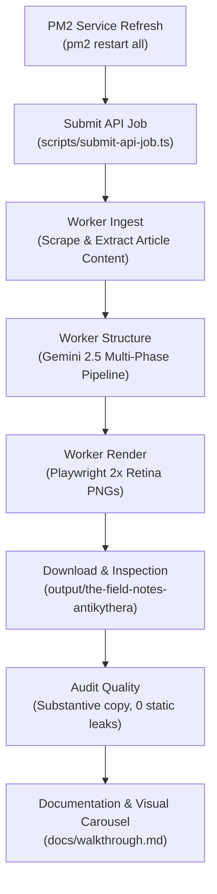

# Implementation Plan: Live Pipeline Audit with New Article (The Field Notes)

## Goal Description
Conduct a complete end-to-end audit of the modularized **The Field Notes** template using a new, substantive article. This verifies that:
1. The new folder-per-component modular architecture ([`cover/`](file:///home/core/projects/loopreel/packages/loop/src/layouts/the-field-notes/cover), [`specimen/`](file:///home/core/projects/loopreel/packages/loop/src/layouts/the-field-notes/specimen), [`measure/`](file:///home/core/projects/loopreel/packages/loop/src/layouts/the-field-notes/measure), etc.) integrates seamlessly with the dynamic Playwright rendering worker and Vite engine.
2. The LLM extraction and structure workers dynamically plan rich, diverse slide types without fallbacks or static text leaks.
3. Every slide renders crisp, substantive, researcher-notebook content at 2x Retina resolution ($2160 \times 2700$).

---

## User Review Required

> [!IMPORTANT]
> **Proposed Article Selection**:
> We recommend **The Antikythera Mechanism** ([Wikipedia Article](https://en.wikipedia.org/wiki/Antikythera_mechanism)) as the primary test subject.
> 
> *Why this article?*
> - The Antikythera mechanism is an ancient Greek hand-powered mechanical orrery, widely regarded as the oldest known analogue computer.
> - Its subject matter (shipwreck recovery in 1901 off Antikythera, 37 interlocking bronze gears, astronomical cycles, X-ray tomography scans) is tailor-made for The Field Notes aesthetic, naturally exercising slide types like `specimen`, `measure`, `log`, `sequence`, `compare`, `table`, and `quote`.
>
> *Alternative articles available if preferred*:
> - **Mariana Trench** (`https://en.wikipedia.org/wiki/Mariana_Trench`) — Hadal ocean exploration, extreme bathymetry measurements, deep-sea specimen catalog.
> - **Second Voyage of HMS Beagle** (`https://en.wikipedia.org/wiki/Second_voyage_of_HMS_Beagle`) — Darwin's natural history survey, route logs, and specimen discoveries.
> - **James Webb Space Telescope** (`https://en.wikipedia.org/wiki/James_Webb_Space_Telescope`) — Infrared optics, L2 orbit telemetry, and astronomical discoveries.

> [!NOTE]
> If you have a different specific URL you would like to test, please mention it when approving the plan!

---

## Proposed Execution Workflow



---

## Step-by-Step Implementation Steps

### 1. Refresh Microservices
Restart all PM2 background services so they load freshly built modular packages and schemas:
```bash
pm2 restart all
```

### 2. Submit API Job with The Field Notes Template
Execute `scripts/submit-api-job.ts` targeting the article:
- **URL**: `https://en.wikipedia.org/wiki/Antikythera_mechanism`
- **Template**: `the-field-notes`
- **Platform**: `instagram-feed` (4:5 aspect ratio, $1080 \times 1350$, rendered at 2x)
- **Wordmark**: `ARCHAEO FIELD LOG`
- **Handle**: `@ArchaeoFieldNotes`
- **Output Directory**: `output/the-field-notes-antikythera/`

```bash
pnpm tsx scripts/submit-api-job.ts \
  --url "https://en.wikipedia.org/wiki/Antikythera_mechanism" \
  --template the-field-notes \
  --platform instagram-feed \
  --wordmark "ARCHAEO FIELD LOG" \
  --handle "@ArchaeoFieldNotes" \
  --outDir output/the-field-notes-antikythera
```

### 3. Asynchronous Pipeline Monitoring
- Observe BullMQ queue progress via `pm2 logs worker-structure` and `pm2 logs worker-render`.
- Track timing metrics: Article extraction latency, Gemini generation latency, Playwright rendering time per slide.

### 4. Quality Audit & Slide Verification
Inspect all rendered slide PNGs for:
- **Slide Count & Type Diversity**: Verify that the deck uses multiple distinct slide types (e.g. `cover`, `specimen`, `sequence`, `compare`, `measure`/`tally`, `quote`, `cta`).
- **Substantive Editorial Content**: Confirm all text is customized to the Antikythera mechanism with technical depth, citations, and real data.
- **Dynamic Frame Metadata**: Confirm page numbering (`PAGE 01`, `PAGE 02`, ...), dot indicators, wordmark (`ARCHAEO FIELD LOG`), and social handle (`@ArchaeoFieldNotes`) render dynamically with zero static placeholder leaks.
- **Visual Typography & Hand-drawn Primitives**: Verify that `Squiggle`, `CircNumber`, `Arrow`, `XMark`, `Box`, and washi tape tags align cleanly.

### 5. Documentation & Artifact Walkthrough
- Copy rendered PNGs to the artifact directory.
- Update [`docs/walkthrough.md`](file:///home/core/projects/loopreel/docs/walkthrough.md) and the walkthrough artifact with a new Section 13: "Live End-to-End Audit: Antikythera Mechanism Field Log", including the interactive visual carousel.
- Commit test documentation to Git.

---

## Verification Plan

### Automated Tests
- Full TypeScript / monorepo build: `pnpm turbo build`
- Multi-template visual suite: `pnpm tsx scripts/test-all-templates-visual.ts`

### Manual / Visual Verification
- Review each rendered slide PNG in `output/the-field-notes-antikythera/` using visual carousels in the walkthrough artifact.
