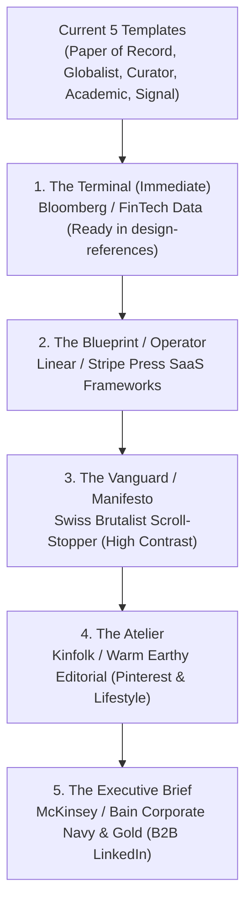

# Strategic Template Catalog Expansion & Archetype Roadmap

## Overview

To validate Loopreel on a new Instagram page and build an organic audience, our templates must target the **highest-performing content niches** across Instagram, LinkedIn, and Pinterest. 

We currently have **5 production templates**:
1. `paper-of-record` (NYT / FT Heritage Broadsheet — investigative journalism & deep-dives)
2. `the-globalist` (Monocle / The Economist — macroeconomic analysis & international affairs)
3. `the-curator` (MoMA / Phaidon — stark minimalist luxury art & architecture)
4. `the-academic` (HBR / MIT Tech Review — scientific peer review & whitepapers)
5. `the-signal` (Substack / B2B Engineering — modern slate & cyan technical breakdowns)

This roadmap outlines the **next 5 templates** to build, ranked by audience virality, market coverage, and immediate availability.

---

## Recommended Template Expansion Roadmap

---

### Priority 1: "The Terminal" (FinTech & Quantitative Data)
- **Status**: ⚡ **Ready in `packages/loop/design-references/The Terminal.html`**
- **Inspiration**: Bloomberg Terminal, Financial Times Markets, Reuters Eikon.
- **Visual Language**: Pitch black background (`#080808`), structural grid lines (`#2A2A2A`), JetBrains Mono typography, neon amber alerts (`#FFB000`), neon green positive deltas (`#00FF41`), ticker-tape header bands.
- **Target Audience / Content**: Crypto breakdowns, stock market earnings teardowns, developer benchmark reports, GPU compute economics, macroeconomic metrics.
- **Why It Wins**: Dark mode technical data carousels consistently achieve the highest bookmark/save rates on Instagram and Twitter/X.

---

### Priority 2: "The Blueprint" / "The Operator" (Modern SaaS & Startup Playbooks)
- **Inspiration**: Linear, Stripe Press, Vercel, Y Combinator startup library.
- **Visual Language**: Clean crisp canvas (off-white `#F8F9FA` or dark obsidian `#0D1117`), razor-sharp 1px border cards, system sans typography (Geist / Inter), subtle electric violet or cobalt accents, pill badges (`v1.4`, `STABLE`, `FRAMEWORK`).
- **Target Audience / Content**: Product management teardowns, SaaS growth strategies, engineering architecture playbooks, founder mental models.
- **Why It Wins**: Dominates LinkedIn and tech Instagram. Perfect for founder personal branding and tech agency lead generation.

---

### Priority 3: "The Vanguard" / "The Manifesto" (Swiss Brutalism & Scroll-Stopping Takes)
- **Inspiration**: Virgil Abloh / Off-White, Ray Gun Magazine, Swiss International Style.
- **Visual Language**: Massive typography that commands attention, ultra-high contrast (stark black + fluorescent hazard yellow `#FAFF00` or electric international orange `#FF4500`), heavy bold sans-serif headlines (Syne or Archivo Black), asymmetric rule dividers.
- **Target Audience / Content**: Unpopular opinions, "Myth vs. Fact" debunking, mindset shifts, disruptive business quotes, viral carousel openers.
- **Why It Wins**: Massive scroll-stopping power. On Instagram feeds where users swipe rapidly, bold brutalist typography stops thumbs within 0.2 seconds.

---

### Priority 4: "The Atelier" (Quiet Luxury, Wellness & Pinterest)
- **Inspiration**: Kinfolk, Cereal Magazine, Architectural Digest, Aesop packaging.
- **Visual Language**: Warm linen and oatmeal tones (`#F5F2EB`, `#E8E2D5`), deep espresso text (`#231F20`), warm terracotta or sage accents, delicate serif display fonts (Cormorant Garamond / Ogg), generous negative space, bordered polaroid-style image cards.
- **Target Audience / Content**: Creative agency portfolios, interior design, psychology & mindfulness, book recommendations, lifestyle guides, Pinterest pins (2:3 format).
- **Why It Wins**: Broadens Loopreel beyond tech and finance into the massive consumer, lifestyle, and design creator markets on Pinterest and Instagram.

---

### Priority 5: "The Executive Brief" (Management Consulting & Corporate B2B)
- **Inspiration**: McKinsey Quarterly, Bain & Company, Boston Consulting Group (BCG).
- **Visual Language**: Deep institutional navy (`#0B1B3D`), crisp white paper, champagne gold or warm copper accents (`#C5A880`), clean hybrid serif/sans typography, structured 2x2 decision matrices, 3-pillar strategy cards.
- **Target Audience / Content**: Executive coaching, corporate strategy, board meeting summaries, B2B sales frameworks, LinkedIn PDF document carousels.
- **Why It Wins**: Perfect anchor for high-ticket consulting agencies and B2B SaaS founders wanting conservative authority on LinkedIn.

---

## Expanding Slide Archetypes (Information Structures)

Along with new visual themes, we should introduce 3 high-leverage slide types into our isolated layouts:

| Slide Type | Layout Structure | Best Used For |
|---|---|---|
| **The Quadrant (2x2 Matrix)** | 4-box grid with X/Y axes (e.g. Impact vs. Effort, Urgent vs. Important) | Frameworks, mental models, BCG matrix |
| **Myth vs. Fact (Binary)** | Split top/bottom or left/right with red/green or muted/bold styling | Debunking common industry misconceptions |
| **The Resource Stack** | 4-card grid listing recommended tools, books, or steps | Curated lists ("Top 4 tools for X") |
