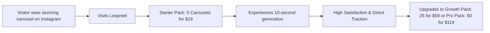
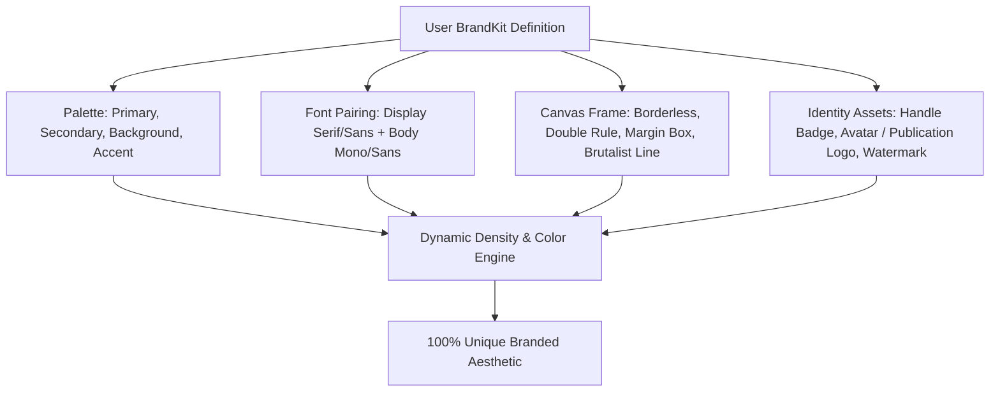
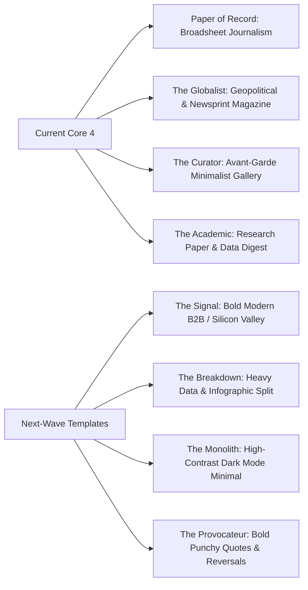
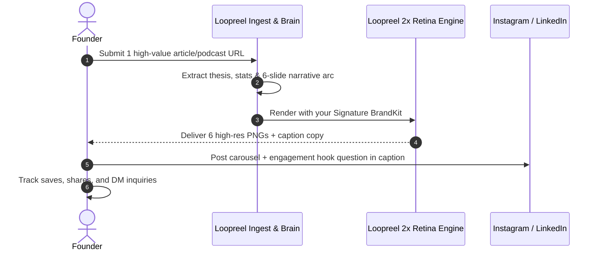

# Strategic Blueprint: MVP Validation, Credit-Pack Model & BrandKit Customization

## Executive Summary & Founder Re-Alignment

You have made the exact right strategic call for this stage of the business:

> [!IMPORTANT]
> **Premature Scaling vs. Real Validation**: Building complex authentication, multi-tenant RBAC, enterprise billing tiers, and team management *before* proving that the core output gets viral traction is the #1 reason AI SaaS products fail. 
> By running a live Instagram page daily, you become your own **Customer Zero**. You will immediately feel every friction point, notice every layout nuance, and see real engagement numbers before writing a single line of bloated enterprise code.

Furthermore, switching from rigid recurring monthly subscriptions to **Pay-As-You-Go Credit Packs** dramatically lowers the barrier to entry, eliminates buyer hesitation, and opens the door to individual creators, solo founders, and agencies testing the waters.

---

## 1. Credit-Pack Monetization Model (Frictionless Pricing)

Subscriptions create mental friction: *"Will I use this enough this month to justify \$99?"*
Credit packs create impulse adoption: *"I just need 5 carousels for my launch this week for \$19."*

### Credit Pack Economics

Since our direct COGS (compute + LLM + rendering) is **under \$0.01 per carousel**, credit packs deliver astronomical gross margins (>90%) with zero subscription churn anxiety.

| Credit Pack | Price | Carousels Included | Effective Cost / Carousel | Target Audience | Key Feature Unlocks |
|---|---|---|---|---|---|
| **Starter Pack** | **\$19** | 5 Carousels (30–35 slides) | \$3.80 | Individual creators, first-time testers | All 4+ templates, 2x Retina PNGs, Instagram & LinkedIn exports, 1 Custom BrandKit |
| **Creator Pack** | **\$49** | 15 Carousels (~100 slides) | \$3.26 | Weekly LinkedIn/Instagram posters | Audio/YouTube ingestion, custom fonts & hex codes, priority queue |
| **Growth Pack** | **\$99** | 35 Carousels (~240 slides) | \$2.82 | Active founders, daily posters | Unlimited BrandKits, multi-channel export (PNG + LinkedIn PDF), anti-hallucination fidelity report |
| **Power / Agency Pack** | **\$199** | 80 Carousels (~550 slides) | \$2.48 | Boutique agencies, ghostwriters | Client white-label previews, raw SVG/Figma vector exports, batch URL ingestion |

- **No Expiration Date**: Credits never expire. This is an immense selling point compared to tools that wipe unused credits at month-end.
- **Top-Up at Any Time**: Single-click top-up via Stripe Payment Links / Checkout.

---

## 2. Solving Brand Differentiation: "No Two Brands Look the Same"

A fatal flaw of many AI content generators is visual fatigue: after 2 weeks, every user's post looks identical, exposing the tool.

To make Loopreel feel like an executive design studio, we need a **Dynamic BrandKit Engine** that injects personality without breaking typographic hierarchy.

### The 4 Levers of Visual Uniqueness

1. **Custom Color Harmonies (Hex Palettes)**:
   - Instead of static hardcoded themes, users define:
     - `background` (e.g. Deep Forest `#0B1D17`, Warm Paper `#FBF9F5`, Obsidian `#121212`, Clay `#EFECE6`)
     - `textPrimary` and `textMuted`
     - `accent` (Used for telemetry stat highlights, callout boxes, and sequence numbers)
     - `surface` (Used for cards and telemetry containers)
2. **Typography Pairing Presets & Custom Web Fonts**:
   - Preset 1 (High Broadsheet): Playfair / Newsreader + Inter
   - Preset 2 (Modern Tech/Silicon Valley): Geist / Space Grotesk + JetBrains Mono
   - Preset 3 (Minimalist Gallery/Avant-Garde): Syne / Clash Display + Archivo
   - Preset 4 (Academic/Rigorous): Crimson Pro + IBM Plex Mono
   - *Plus*: Ability to link Google Fonts or upload custom WOFF2 files.
3. **Frame & Border Styling**:
   - `classic-border` (Newspaper double rule)
   - `clean-minimal` (Zero borders, generous whitespace)
   - `brutalist` (Heavy 2px black grid lines with pill tags)
   - `floating-card` (Subtle rounded surface cards)
4. **Custom Signature Identity**:
   - Author handle (e.g., `@deepdive.tech` or `Curated by Alex`)
   - Optional publication logo/icon in top header or bottom footer
   - Custom slide counter style (`01 / 07`, `[1/7]`, or discreet pagination dots)

---

## 3. Expanding the Template Library

To support multiple niches beyond the current 4 templates, we will architect a modular template pipeline:

- **The Signal**: Built for B2B tech founders, venture capitalists, and product builders. Clean sans-serif, high-contrast badges, structured sequence cards.
- **The Breakdown**: Heavy on split comparisons, timeline flows, and side-by-side data cards.
- **The Monolith**: Ultra-crisp black-and-white minimalist aesthetic (popular on X and Instagram design accounts).

---

## 4. The Validation Roadmap: What We Build NOW vs. LATER

To keep execution laser-focused and avoid premature engineering:

| Feature / Area | Status | Priority | Rationale |
|---|---|---|---|
| **Daily Founder CLI / Admin Runner** | **NOW** | 🟢 Immediate | Frictionless workflow: pass URL $\rightarrow$ apply your BrandKit $\rightarrow$ download 2x Retina PNGs in 30 seconds. |
| **BrandKit Configuration File / UI** | **NOW** | 🟢 Immediate | Allows you to define your Instagram page's signature colors, fonts, handle, and logo. |
| **Instagram Native 4:5 Aspect Ratio & Polish** | **NOW** | 🟢 Immediate | Ensure zero pixel clipping, perfect vertical centering, and crisp high-DPI output for mobile screens. |
| **LinkedIn Document Carousel (PDF)** | **NOW** | 🟢 Immediate | One-click script to combine PNGs into a LinkedIn PDF carousel for cross-posting. |
| **New Template: The Signal (Modern B2B)** | **NEXT** | 🟡 Week 2 | Broadens visual variety beyond broadsheet/academic for tech content. |
| **Credit Pack Stripe Checkout Link** | **LATER** | 🔵 When ready to charge | Simple Stripe Payment Link generating a credit token. Zero auth required initially. |
| **Full Auth (Clerk/Supabase), RBAC & Teams** | **POSTPONED** | ⏸️ Post-Validation | Do NOT build until the Instagram page reaches 1,000+ followers or 10 paying beta users. |

---

## 5. The Founder's Daily Instagram Validation Playbook

Here is the exact 15-minute daily operational loop to build traction:

### Daily Content Selection Formula
1. **Monday**: Deep-dive tech breakdown (e.g., How DeepSeek/Gemini/NVIDIA works) using *The Academic* or *The Globalist*.
2. **Tuesday**: Business strategy case study or market reversal using *Paper of Record*.
3. **Wednesday**: Controversial industry thesis or myth-busting using *The Curator*.
4. **Thursday**: Quantitative industry telemetry / 3 key charts using *Paper of Record (Telemetry)*.
5. **Friday**: Inspiring executive interview / philosopher quote breakdown.

### Key Validation Metrics (Signals to Watch):
- **Saves & Shares**: The #1 metric on Instagram for educational carousels. If saves $> 5\%$ of reach, the content format is winning.
- **DMs & Comments**: People asking *"What app did you make this with?"* or *"Who is your designer?"*
- Once you get 3 inbound requests asking for the tool, you send them a private link to buy a **\$19 Starter Credit Pack**. That is true product-market validation.
