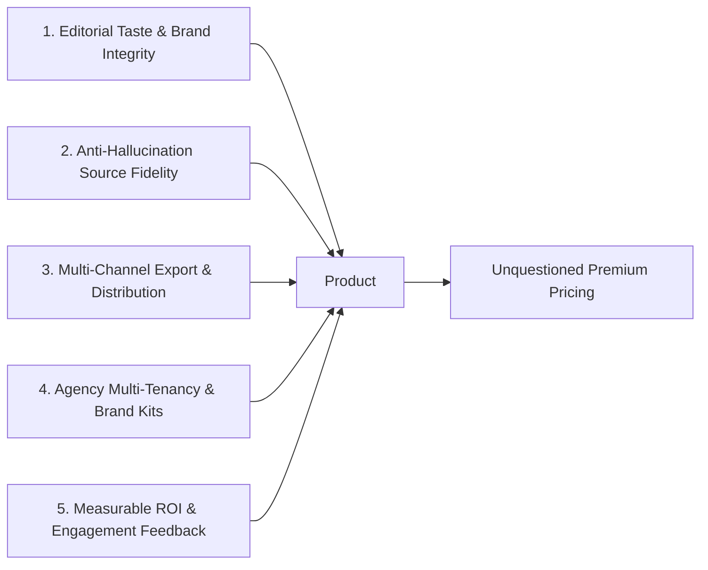
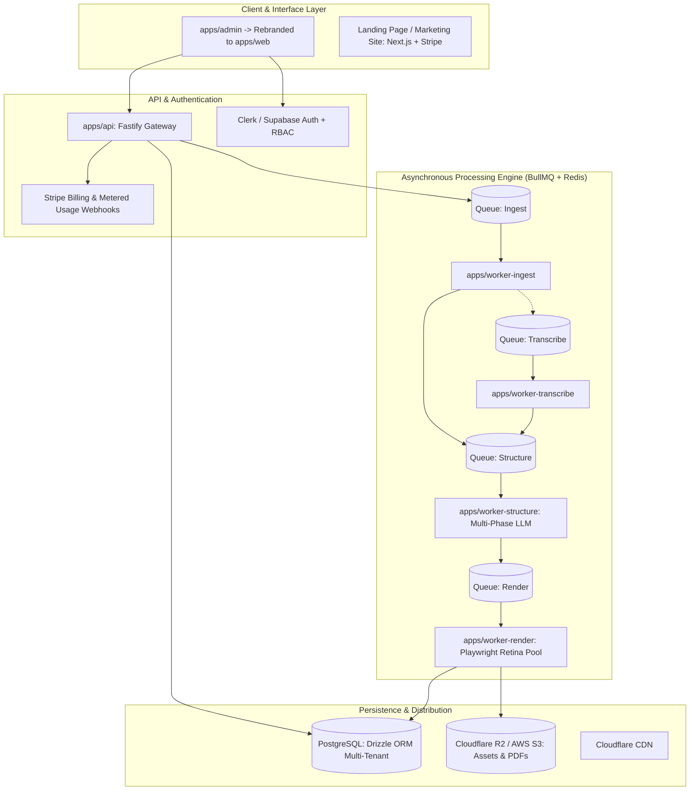
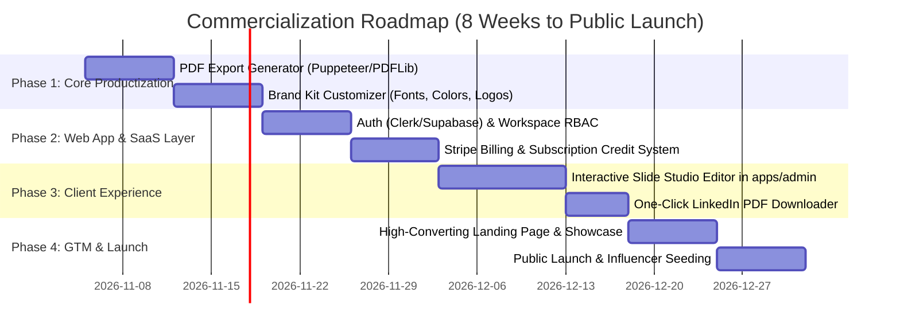

# Strategic Blueprint: Launching Loopreel as a Premium B2B SaaS

## Executive Summary & Core Philosophy

If we launch Loopreel as "just another AI social media post generator", we immediately enter a race to the bottom against Canva, generic wrapper tools, and free ChatGPT prompts charging \$9–\$19/month with massive churn.

To command and justify a **premium price tag (\$99–\$499+/month)**, the product must solve an expensive, high-stakes business problem: **High-authority B2B content repurposing and personal brand equity without hiring a \$5,000/month creative agency.**

```mermaid
flowchart TD
    subgraph MarketTrap ["The Low-Value Trap ($9-$19/mo)"]
        A[Generic AI Generator] --> B[Cliché AI Templates & Emojis]
        B --> C[Looks Cheap / Obvious AI]
        C --> D[Executives Refuse to Post It]
        D --> E[High Churn & Zero Pricing Power]
    end

    subgraph PremiumPosition ["The Loopreel Moat ($99-$499/mo)"]
        F[High-Density Ingestion: Substack, Whitepapers, Video] --> G[Multi-Phase AI Editorial Brain]
        G --> H[Mathematical Density Engine & Bespoke Typographic Aesthetics]
        H --> I[2x Retina LinkedIn PDFs & Social Carousels]
        I --> J[Indistinguishable from a $5,000/mo Design Studio]
        J --> K[Retention & Premium Willingness-to-Pay]
    end
```

---

## 1. The Ideal Customer Profile (ICP) & The "Anchor Price"

Premium pricing is never justified by your costs; it is justified by the **Alternative Cost of Inaction or Replacement** (Anchor Pricing).

### Who Pays \$99 – \$799/month without blinking?

| Customer Persona | Their Current Alternative | Their Current Spend | Loopreel Value Proposition | Justified Price Point |
|---|---|---|---|---|
| **B2B Founders & Tech Executives** | Hiring an agency or ghostwriter + freelance designer | \$3,000 – \$8,000 / month | Turn long-form thinking, podcasts, or company blog posts into authoritative thought-leadership carousels in 90 seconds. | **\$149 – \$249 / month** (Pro / Executive) |
| **Content Marketing Agencies & Ghostwriters** | Junior designers spending 4–6 hours per carousel in Figma/Canva | \$40 – \$75 / hour (\$1,500/mo per client) | 10x throughput. Produce 20 branded client carousels per week with custom brandkits, typography, and anti-hallucination source fidelity. | **\$399 – \$799 / month** (Agency / Multi-seat) |
| **B2B SaaS Marketing Teams (Demand Gen)** | Underutilized whitepapers, webinars, and case studies sitting in PDFs | High CAC (\$200–\$800 per lead) | Repurpose 1 webinar/whitepaper into 5 high-converting LinkedIn carousel PDFs, X threads, and IG slides with zero design bottlenecks. | **\$299 – \$499 / month** (Team) |
| **Substack Authors & Newsletter Publishers** | Text-heavy newsletters that struggle to get viral reach on social | Low subscriber growth | Turn 2,500-word newsletters into 7-slide viral visual carousels with 1 click. | **\$79 – \$149 / month** (Creator Pro) |

> [!IMPORTANT]
> **The Golden Rule of Premium B2B SaaS**: If your software saves 10 hours of a designer's time or replaces half of an agency retainer, charging \$199/month represents a **10x to 25x ROI** for the buyer.

---

## 2. The 5 Pillars that Justify Premium Pricing

To make a customer feel confident paying \$1,500 to \$5,000 annually, the product must provide five distinct pillars that free or cheap tools cannot match:

### Pillar 1: "Design Agency Grade" Aesthetic (No "Canva Slop")
Cheap tools use garish gradients, random stock photos, and amateur typography that serious professionals refuse to put their names behind.
- **Loopreel's Edge**: The 4 specialized design systems (`The Paper of Record`, `The Globalist`, `The Curator`, `The Academic`) look like they were custom-crafted by an art director in London or New York.
- **Dynamic Density Engine**: Sizing, card heights, and leading dynamically adjust to the copy length mathematically so text never overflows or leaves clumsy whitespace voids.
- **2x Retina Resolution**: Pixel-perfect $2160 \times 2700$ renders suitable for executive presentations and crisp LinkedIn PDF readers.

### Pillar 2: Multi-Phase Cognitive Extraction (Not Just a Prompt)
Most AI tools dump a prompt into ChatGPT: *"Summarize this article into 5 slides"*, which outputs trite, superficial bullet points.
- **Loopreel's Edge**: 
  - **Phase 0 (Input Validation)**: Rejects paywalls, cookie banners, and low-information text.
  - **Phase 1 (Brief & Hook Extraction)**: Extracts the controversial thesis, narrative friction, and statistical proofs.
  - **Phase 3 (Editorial Blueprint)**: Structures a proven storytelling arc (Hook $\rightarrow$ Evidence $\rightarrow$ Reversal $\rightarrow$ Telemetry $\rightarrow$ Payoff $\rightarrow$ Action).
  - **Phase 4.7 (Fidelity Audit)**: Cross-references generated stats against original text to guarantee zero hallucinated data before rendering.

### Pillar 3: Multi-Platform Native Formats
Professionals do not publish to just one platform.
- **Export Formats**:
  - **LinkedIn Document Carousel (PDF)**: High-resolution multipage PDF optimized for LinkedIn's document viewer (the #1 organic reach format on LinkedIn).
  - **Instagram Carousel (PNG / 4:5 Portrait & 9:16 Stories)**.
  - **X/Twitter Thread with Visual Media Attachments**.
  - **Figma / Vector Export (Agency tier)**: Allows creative directors to tweak the raw canvas if needed.

### Pillar 4: Agency Multi-Tenancy & Dynamic Brand Kits
- Upload corporate fonts (OTF/WOFF2), custom HEX palettes, watermarks, logo positioning, and legal disclaimers.
- Multi-brand workspaces: Switch between "Client A (Healthcare Tech)", "Client B (Fintech)", and "Internal Brand" with a single click.

### Pillar 5: Direct Publishing & Engagement Analytics
- One-click scheduling via LinkedIn, X, and Meta APIs.
- Feedback loop: Analyze which slide formats (e.g. `telemetry` vs. `myth-fact`) generated the highest comment rate, feeding insights back into the AI structuring prompt.

---

## 3. Product Architecture from Scratch (Built for SaaS Scale)

To deliver this commercially, we take our existing proven monorepo foundation and augment it with the SaaS billing, tenancy, and delivery layers:

### Key Additions to Turn Current Monorepo into Commercial SaaS:

1. **Authentication & Multi-Tenancy (RBAC)**:
   - Tenant isolation at database level (`workspace_id` in PostgreSQL).
   - Roles: `Owner`, `Editor`, `Viewer`, `Agency Client (Preview only)`.
2. **Stripe Integration & Metered Credit Engine**:
   - Monthly base credits (e.g., 30 carousels / 200 slides per month).
   - Top-up credit purchasing for high-volume agencies.
3. **PDF Packaging Service**:
   - Merge rendered 2x Retina PNGs into a compressed, high-DPI vector-grade PDF for LinkedIn Document Carousels.
4. **Interactive Studio Canvas in Web App**:
   - Currently, `apps/admin` is an operations monitor. We evolve it into the **End-User Studio**:
     - Left: Real-time copy & stat editor with live density recalculation.
     - Center: Pixel-perfect slide preview carousel.
     - Right: Brand kit switcher (fonts, colors, layout rules).
     - Header: "Export as LinkedIn PDF", "Export as PNG ZIP", "Schedule to LinkedIn".

---

## 4. Packaging, Tiers & Unit Economics

### Pricing Tiers

| Tier | Monthly Price (Annual Billing) | Target User | Inclusions | Core Restrictions |
|---|---|---|---|---|
| **Starter / Creator** | **\$49 / mo** (\$39 / mo billed annually) | Independent writers, newsletter authors, solo founders | - 20 Carousels / mo - All 4 Editorial Templates - 2x Retina PNG & LinkedIn PDF export - Unsplash High-Res Curation - 1 Brand Kit | 1 User, Loopreel subtle watermark on CTA slide |
| **Pro / Executive** | **\$149 / mo** (\$119 / mo billed annually) | Founders, VCs, B2B executives, consultants | - 60 Carousels / mo - Zero Watermark - Custom Brand Fonts & Palettes - Audio / YouTube ingestion - Anti-hallucination verification reports - Priority rendering queue | 2 Users, 3 Brand Kits |
| **Agency & Teams** | **\$399 / mo** (\$329 / mo billed annually) | Content marketing agencies, corporate B2B marketing teams | - 250 Carousels / mo - Unlimited Brand Kits - Client White-Label Approval Links - 5 Team Seats included - Direct LinkedIn/X scheduling - Dedicated Slack channel | Multi-seat, \$49/mo per additional seat |
| **Enterprise** | **Custom (\$1,200+/mo)** | Large enterprises, media publications | - Unlimited carousels - Custom bespoke template developed by Loopreel design team - SSO (Okta/SAML) - Dedicated worker rendering cluster | SLA, Custom legal terms |

---

### Unit Economics & Gross Margins

Let's inspect the actual marginal cost to produce one 6-slide carousel on Loopreel:

| Resource | Service / Provider | Consumption per 6-Slide Carousel | Estimated Cost (USD) |
|---|---|---|---|
| Ingestion & Scraping | Headless Puppeteer / Readability | 1 scraping execution | \$0.0005 |
| LLM Phases (0 through 4.7) | Google Gemini 2.5 Flash / GPT-4o-mini | ~12,000 input tokens + ~2,500 output tokens | \$0.0035 |
| Imagery | Unsplash API / Cache | 2–3 photo queries | \$0.0000 (Free Tier / \$0.001 at scale) |
| Playwright Rendering | Chromium 2x Retina screenshot pool | 6 slides @ 1.2s each (7.2s headless browser time) | \$0.0040 (Server compute) |
| Cloud Storage & CDN | Cloudflare R2 + CDN | 6 PNGs + 1 PDF (~15 MB storage + egress) | \$0.0002 |
| **Total Marginal Cost Per Carousel** | | | **~\$0.0082 (Less than 1 cent!)** |

> [!NOTE]
> Even on the \$49/month Starter plan with 20 carousels, our direct COGS (cost of goods sold) is less than **\$0.20 per customer per month**.
> **Gross Margins exceed 95%**, leaving massive headroom for marketing, acquisition, and team salaries.

---

## 5. Go-To-Market (GTM) & Customer Acquisition Strategy

How do we acquire premium customers who gladly pay \$149–\$399/month?

### Strategy 1: "Dogfooding in Public" (The Trojan Horse)
- Every day, Loopreel automatically ingests the top 3 trending tech/business essays (e.g., Paul Graham, Ben Thompson, Lenny's Newsletter) and renders them into gorgeous carousels.
- Post them on LinkedIn and X, tagging the original author: *"Turned [Author]'s 3,000-word essay into a 6-slide visual breakdown with Loopreel."*
- B2B executives will immediately see the quality difference and comment: *"What tool did you use to make this?"*

### Strategy 2: "Free Teaser" Micro-Tool for Lead Generation
- A public landing page tool: **"LinkedIn Carousel Inspector & Grader"** or **"1-Click Substack-to-Carousel Preview"**.
- Users paste their article URL. Loopreel renders Slide 1 (Cover) and Slide 2 for free in the browser with watermark.
- To download the full 7-slide 2x Retina PDF with no watermark, they start a 7-day Pro trial.

### Strategy 3: The Agency Trojan Horse
- Target LinkedIn ghostwriters and boutique B2B agencies.
- Offer them a free 14-day Agency Pass. Once a ghostwriter experiences turning a 1-hour interview transcript into a week's worth of client-approved carousels in 5 minutes, they cannot return to manual Canva work.

---

## 6. Execution Roadmap: From Current Codebase to Commercial Launch

### Proposed Action Items:
1. **Milestone 1**: Implement **LinkedIn PDF Compiler** in `worker-render` (combines the 2x Retina PNGs into an optimized PDF).
2. **Milestone 2**: Build the **Interactive Slide Studio** in `apps/admin` (now the primary user-facing SaaS dashboard).
3. **Milestone 3**: Integrate **Stripe Billing** + **Clerk Authentication** with multi-tenant workspace isolation.
4. **Milestone 4**: Launch public-facing landing page with live interactive demo.
